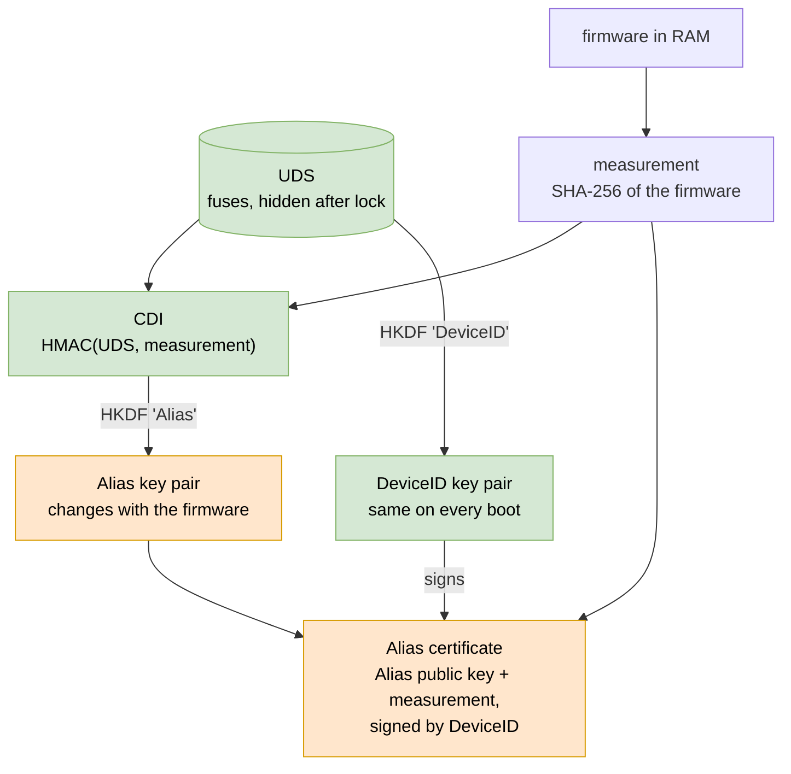
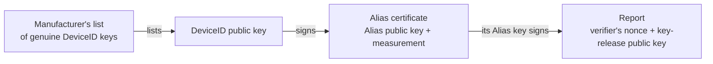
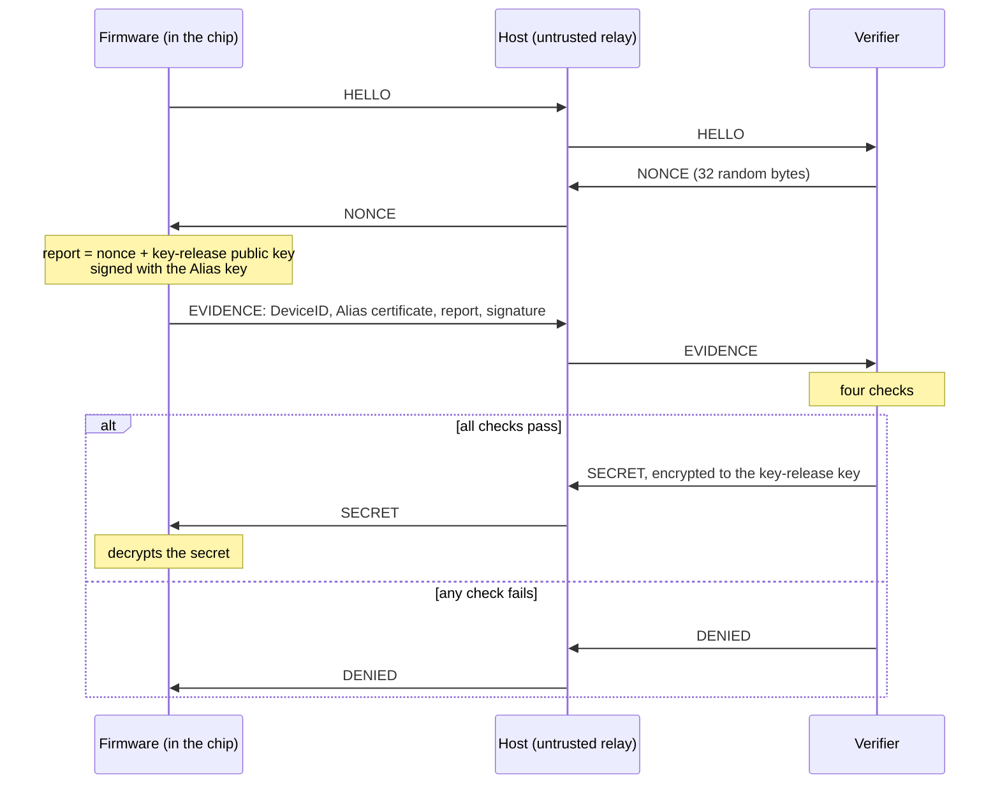

# Proving What Runs: DICE, Attestation and Confidential Computing on a Simulated SoC

*Audience: you write or run system software and have read [Where Trust Begins](soc-root-of-trust-blog.md), the first post in this series. You know what a boot ROM, OTP fuses and a lock bit do. You have heard "confidential computing" and "attestation" and want a mental model you can check against real hardware. We'll extend the lab SoC from the first post until it can prove to a remote server which firmware it runs, and receive a secret only if the answer is right.*

---

## 1. Where the first post stopped

The first lab ended with measured boot. The boot ROM hashed the firmware and froze the hash in a register that the firmware couldn't change. The evil firmware booted, but its measurement gave it away, and the post said "a remote verifier would refuse".

That sentence skipped the hard part. The verifier sits somewhere else, on a server. It can't read the chip's registers. It only sees bytes that arrive over a network, and the firmware it wants to judge is the one sending those bytes. An evil firmware can read the frozen register and then send whatever value it likes.

So the verifier needs more than a hash. It needs a statement about the firmware, signed with a key that:

1. only this chip holds, and
2. the firmware can't use to sign false statements.

This post builds that key, the statement and the verifier. Along the way it explains confidential computing, because confidential computing rests on the same mechanism.

---

## 2. Confidential computing in one picture

In a normal cloud server, you trust the people who run it. Their hypervisor can read your VM's memory, and their administrators can dump it. Confidential computing removes that trust: **the host OS, the hypervisor and the cloud operator become the attacker.** The tenant trusts the CPU's hardware and a small amount of firmware, and nothing else on the machine.

Three hardware features make that possible:

| Property | The question it answers | AMD SEV-SNP | Intel TDX | Arm CCA |
|---|---|---|---|---|
| **Isolation** | Who may access this page of memory? | Reverse Map Table (RMP) | TDX module in SEAM mode | Granule Protection Table (GPT) |
| **Memory encryption** | What does a bus probe or a DMA engine see? | AES engine, one key per VM | MKTME, one key per TD | Memory Encryption Contexts (MEC) |
| **Attestation** | How does a remote party know what runs? | Report signed by the VCEK key | Quote from the quoting enclave | Token from the RMM and the platform RoT |

The diagram shows where those pieces sit in an SoC that supports confidential computing:


Green blocks belong to the tenant's trusted computing base, blue marks the workload they protect, and red blocks may be hostile. In this design:

- **Every memory access passes the access check and the encryption engine.** The hypervisor still schedules the VM and manages its memory, but it can't read or rewrite the VM's pages. If it reads them through DRAM or DMA, it sees ciphertext.
- **The security processor holds the root of everything.** It boots first, from its own ROM, with its own fuses. It installs the per-VM keys, and it signs the attestation report. In AMD's design it is the AMD Secure Processor, a separate Arm core on the CPU die. Arm's CCA reference designs also put the root of trust on its own core.

Isolation and encryption keep the hypervisor out. They don't tell the tenant anything, though. A tenant who uploads a disk key to a cloud VM needs proof that the VM is a confidential VM on genuine hardware, running the expected code, before sending the key. That proof is attestation, and the rest of this post is about it. The lab builds the attestation half. Isolation and encryption get a short section at the end.

---

## 3. Identity: a key that depends on the firmware

Attestation needs a signing key with two properties:

1. **It belongs to this chip.** A verifier must be able to tell a genuine chip from a simulator that makes up answers.
2. **It changes when the firmware changes.** Otherwise an evil firmware could sign "I am the official firmware" with the same key the official firmware uses.

The Trusted Computing Group's **DICE** (Device Identifier Composition Engine) design gets both properties from three steps:

1. **UDS.** At manufacturing, the chip receives a random *Unique Device Secret* in its fuses. Nothing outside the chip ever learns it. (In the lab, a script plays the fab and writes it.)
2. **CDI.** At every boot, the ROM measures the firmware and combines that measurement with the UDS: `CDI = HMAC(UDS, measurement)`. The result is the *Compound Device Identifier*.
3. **Keys from the CDI.** The ROM turns the CDI into a signing key pair, the *Alias* key, and hands it to the firmware.

Change one byte of firmware and the measurement changes. The CDI changes with it, and so does the Alias key, without the ROM checking anything.

The ROM also derives a second key from the UDS alone, the **DeviceID** key. It stays the same on every boot and acts as the chip's long-term identity. The manufacturer records the DeviceID public key at the fab and publishes it, so verifiers can recognize genuine chips. The DeviceID private key never leaves the ROM's run: the ROM uses it once, to sign a certificate for the Alias key, and then wipes it.



The green items exist only inside the ROM's run. The orange items are what the ROM hands to the firmware: the Alias key pair and its certificate. The firmware never sees the UDS, the CDI or the DeviceID private key.

Real chips follow the same pattern with more layers. Each boot stage measures the next one and derives the next CDI, so a chain of keys covers ROM, firmware, bootloader and kernel. Caliptra, an open-source root of trust for datacenter SoCs, implements DICE in its ROM. AMD's VCEK follows the same idea: AMD derives it from a chip-unique secret and the version numbers of the security processor's firmware, so the key changes when that firmware changes.

---

## 4. A chain of signatures

The verifier now receives three things and can check them in order:



Each link answers one question:

| Link | Question | What breaks it |
|---|---|---|
| Manufacturer → DeviceID | Is this a genuine chip? | A simulator or a clone that invents its own keys |
| DeviceID → certificate | Did this chip's ROM issue this certificate? | Firmware that writes its own certificate |
| certificate → measurement | Does the chip run the vendor's firmware? | Modified firmware: the ROM certifies its real measurement |
| Alias key → report | Did the certified firmware produce this answer, for this request? | Replaying an old certificate, or answering from a different firmware |

The **nonce** in the report matters. The verifier picks a fresh random number for each attestation. Without it, an attacker could record the evidence from one official boot and replay it forever.

The report also carries a **key-release public key**, an X25519 key the firmware creates for this attestation. When the verifier approves, it encrypts the secret to that key. Only the firmware that signed the report holds the matching private key, so the host that relays the messages can't read the secret.

The TPM world uses the same structure under different names: an *Endorsement Key* certified by the manufacturer plays the DeviceID role, and an *Attestation Key* signs quotes over measurements and a nonce.

---

## 5. The attestation protocol



Every message passes through the host, and the host may be hostile. The design doesn't need to trust it:

- It can't forge a certificate, because it has no DeviceID private key.
- It can't sign a fresh report, because it has no Alias private key.
- It can't read the secret, because it has no key-release private key.

It can drop messages and stop the attestation. Confidential computing accepts that risk: a hostile host can deny service, but it can't steal the secret or fake the evidence.

In production, this pattern shows up as a key broker. In the Confidential Containers project, for example, a confidential VM sends its attestation evidence to a service called Trustee, which checks it against reference values and then releases keys to the VM. On Linux, a guest asks the CPU for a report through the `configfs-tsm` interface (`/sys/kernel/config/tsm/report`), which works for both SEV-SNP and TDX guests.

---

## 6. Hands-on: an SoC that attests

### 6a. What changed from the first lab

The lab lives in [`cc-attest-lab/`](cc-attest-lab/), a separate copy of the first lab:

```
cc-attest-lab/
├── Containerfile     toolchain: LiteX 2026.08, Verilator, RISC-V GCC, Python cryptography
├── cc_soc.py         the SoC, the fab and vendor steps, and the host relay
├── verifier.py       the remote verifier: four checks, then key release
└── sw/
    ├── bootrom.c     DICE boot ROM
    ├── firmware.c    firmware that attests and receives a secret
    ├── handoff.h     what the ROM leaves in RAM for the firmware
    ├── sha256.c      the measurement hash, unchanged from the first lab
    └── monocypher/   Monocypher 4.0.2: Ed25519, X25519, HMAC, HKDF (BSD-2 or CC0)
```

The lab SoC is the first post's chip with a new ROM and a new fuse layout. The same VexRiscv CPU, interconnect and memory map carry over:


Compare it with the generic picture in §2. In the lab, the main CPU does the security processor's job by running ROM code, as in the first post. The dashed box marks where a real CC chip puts its access check and encryption engine, and §7 covers that gap.

The hardware changes are small:

| | First lab | This lab |
|---|---|---|
| RoT fuses | golden firmware digest, length, enforce bit | one 256-bit UDS |
| RoT registers | fuses, lock, measurement | UDS, lock |
| Boot ROM | 32 KiB: hash and compare | 64 KiB: hash, derive keys, sign |
| SRAM | 8 KiB | 16 KiB |

The RoT block shrinks. The first lab needed a measurement register so the firmware couldn't change the hash. DICE puts the measurement into the Alias certificate instead, signed with a key the firmware never sees, so this lab drops the register.

```python
class RootOfTrust(LiteXModule):
    def __init__(self, uds_words):
        self.uds    = CSRStatus(256, description="Unique Device Secret (OTP). Reads 0 once locked.")
        self.lock   = CSRStorage(1)
        self.locked = CSRStatus(1)
        ...
        self.sync += If(self.lock.re & self.lock.storage[0], locked.eq(1))
        self.comb += [
            self.locked.status.eq(locked),
            self.uds.status.eq(Mux(locked, 0, Cat(*reversed([port.dat_r for port in ports])))),
        ]
```

The same `Mux(locked, 0, …)` from the first post hides the UDS after the lock. Everything else happens in software, in the ROM.

The crypto comes from [Monocypher](https://monocypher.org), a small C library: Ed25519 for signatures, X25519 for the key exchange, HMAC and HKDF with SHA-512 for key derivation. On the simulated CPU, generating one Ed25519 key pair takes about 1.6 million cycles, and one signature about 1.7 million. A full boot and attestation takes around 15 seconds of wall time.

`cc_soc.py` plays four roles before the chip powers on, and prints a line for each:

- **fab:** gives the chip a random UDS once (`build/fab/uds.bin`) and computes the DeviceID public key the way the ROM will. Real chips create the UDS on the die, for example with a PUF, and only the public key ever leaves.
- **vendor:** publishes the reference measurement, the SHA-256 of the official 32 KiB firmware partition.
- **attacker:** with `--tamper`, patches the firmware in RAM before boot.
- **host:** runs the simulator and relays messages. Lines that start with `[` go to your terminal. Protocol lines go to the verifier. With `--replay`, the host turns hostile and rewrites the evidence.

### 6b. Setup

Same as the first lab, with a new image name:

```bash
cd cc-attest-lab
podman build -t cc-attest-lab .
alias lab='podman run --rm -it -v "$PWD":/lab:Z -w /lab cc-attest-lab'
```

Natively, add the Python `cryptography` package to the first lab's tool list.

Your keys and nonces will differ from the ones below: your chip gets its own random UDS, and the verifier picks a new nonce on every run. Delete `build/` to make a new chip.

### 6c. The DICE boot ROM

The core of `sw/bootrom.c`, after measuring the firmware:

```c
/* 2. Copy the UDS out of the fuses, then lock: from here on the fuses read as zero. */
for (int i = 0; i < 8; i++)
	words[i] = csr_read_simple(CSR_ROT_UDS_ADDR + 4 * i);
words_to_bytes(words, uds, 8);
rot_lock_write(1);

/* 3. DeviceID key: depends only on the UDS, so it is the same every boot. */
crypto_sha512_hkdf(seed, 32, uds, 32, NULL, 0, (const uint8_t *)"DeviceID", 8);
crypto_ed25519_key_pair(device_priv, h->device_id_pub, seed);

/* 4. CDI: depends on the UDS and on the measurement. */
crypto_sha512_hmac(cdi, uds, 32, h->cert.measurement, 32);

/* 5. Alias key: derived from the CDI, so it changes whenever the firmware changes. */
crypto_sha512_hkdf(seed, 32, cdi, 64, NULL, 0, (const uint8_t *)"Alias", 5);
crypto_ed25519_key_pair(h->alias_priv, h->cert.alias_pub, seed);

/* 6. Certify: "this Alias key belongs to firmware with this measurement", signed by DeviceID. */
crypto_ed25519_sign(h->cert.signature, device_priv, tbs, sizeof tbs);
```

Then it wipes `uds`, `cdi`, `seed` and `device_priv`, and jumps to the firmware.

Notice the order in step 2. The ROM copies the UDS and locks the RoT before any key derivation, so the fuses stay readable for a few instructions only. The secret then exists in one place, the ROM's stack, until the wipe.

The ROM leaves its results in RAM above the firmware partition, in the layout from `sw/handoff.h`:

```c
struct alias_cert {
	uint8_t alias_pub[32];
	uint8_t measurement[32];   /* SHA-256 of the firmware partition */
	uint8_t signature[64];     /* Ed25519 by DeviceID over alias_pub || measurement */
};

struct dice_handoff {
	uint32_t magic;
	uint8_t  device_id_pub[32];  /* the chip's long-term identity */
	uint8_t  alias_priv[64];     /* the firmware's own signing key */
	struct alias_cert cert;
};
```

The firmware gets the Alias private key, the certificate and the DeviceID *public* key. The struct has no field for anything the firmware must not know.

### 6d. The verifier

`verifier.py` trusts two published facts: the manufacturer's list of DeviceID keys and the vendor's reference measurement. Its four checks map one-to-one onto the chain in §4:

```python
checks = [
    (device_id.hex() in endorsed,
     "the DeviceID key belongs to a genuine chip (manufacturer's list)"),
    (signed_by(device_id, cert_sig, alias_pub + measurement),
     "that chip's ROM signed the Alias certificate"),
    (measurement.hex() == reference,
     f"the certified measurement {measurement.hex()[:16]}... is the vendor's firmware"),
    (report_nonce == nonce and signed_by(alias_pub, report_sig, report),
     "the report carries our nonce and is signed by the certified Alias key"),
]
```

If all four pass, the verifier generates its own X25519 key, computes a shared secret with the key from the report, and uses it to encrypt the secret. The firmware repeats the computation on its side and decrypts.

### 6e. Run 1: official firmware, secret released

```bash
lab ./cc_soc.py
```

```
[fab] chip provisioned, DeviceID public key a6e2bcd02f28b90165a2ba42b64b448f9a5a8a5bce98a717ec0a77a466b48329
[vendor] reference measurement f31e21ed845a7cf24cf213aeaa61c50a3cb2faa5b2b2f314a581fa71e9203a67

[rom] reset vector reached, DICE boot ROM running
[rom] firmware measurement : f31e21ed845a7cf24cf213aeaa61c50a3cb2faa5b2b2f314a581fa71e9203a67
[rom] UDS copied, RoT locked
[rom] DeviceID public key  : a6e2bcd02f28b90165a2ba42b64b448f9a5a8a5bce98a717ec0a77a466b48329
[rom] Alias public key     : e037da5c35868ffc0a864ec2ffb21cebdd537eb608b46eb038f16acc02f644b5
[rom] Alias certificate signed with the DeviceID key
[rom] UDS, CDI and DeviceID private key wiped, jumping to firmware @ 0x40000000
[fw] hello from the official firmware
[fw] the ROM left me an Alias key and its certificate
[verifier] chip said HELLO, sent nonce 3d196ab244d138e6...
[verifier] got evidence, appraising:
[verifier]   ok   the DeviceID key belongs to a genuine chip (manufacturer's list)
[verifier]   ok   that chip's ROM signed the Alias certificate
[verifier]   ok   the certified measurement f31e21ed845a7cf2... is the vendor's firmware
[verifier]   ok   the report carries our nonce and is signed by the certified Alias key
[verifier] secret released, encrypted to the key in the report
[fw] unwrapped the secret: "tenant-42 disk key: open sesame!"
```

Compare the `[fab]` line with the ROM's DeviceID line. Python computed the key at the fab, and the C code in the ROM computed it again from the fuses. Both give `a6e2bc…`. The verifier never learns the UDS. It only checks that `a6e2bc…` appears on the manufacturer's list.

### 6f. Run 2: modified firmware, secret refused

```bash
lab ./cc_soc.py --tamper
```

```
[attacker] patched firmware, it now measures f9958c81a0959a87a0eaa02c525d4cc60b08c0ef016f82055503547685ecdc8c
[build] RTL unchanged, reusing the compiled simulator

[rom] reset vector reached, DICE boot ROM running
[rom] firmware measurement : f9958c81a0959a87a0eaa02c525d4cc60b08c0ef016f82055503547685ecdc8c
[rom] UDS copied, RoT locked
[rom] DeviceID public key  : a6e2bcd02f28b90165a2ba42b64b448f9a5a8a5bce98a717ec0a77a466b48329
[rom] Alias public key     : 6a4dcc3b2582d5e0002667a024a51716b7405b0eaf389f085b9dcf3a579a9f5e
[rom] Alias certificate signed with the DeviceID key
[rom] UDS, CDI and DeviceID private key wiped, jumping to firmware @ 0x40000000
[fw] hello from the EVIL  firmware!!!
[fw] the ROM left me an Alias key and its certificate
[verifier] chip said HELLO, sent nonce 0105db8a6ddf768f...
[verifier] got evidence, appraising:
[verifier]   ok   the DeviceID key belongs to a genuine chip (manufacturer's list)
[verifier]   ok   that chip's ROM signed the Alias certificate
[verifier]   FAIL the certified measurement f9958c81a0959a87... is the vendor's firmware
[verifier] secret NOT released
[fw] verifier said: DENIED evidence failed appraisal
```

Look at the two key lines from the ROM:

- **DeviceID** stays `a6e2bc…`. Same chip, same UDS.
- **Alias** changes from `e037da…` to `6a4dcc…`. The CDI mixes in the measurement, so new firmware gets a new key.

The evil firmware runs and talks to the verifier, and it even tells the truth: it sends the certificate the ROM gave it. The ROM put the real measurement into that certificate and signed it, so check 3 fails. The evil firmware can't produce a certificate with the official measurement, because that needs the DeviceID private key, which the ROM wiped before the firmware started.

### 6g. Run 3: a hostile host replays an official certificate

The evil firmware can't forge a certificate, but the host can copy one. Run 1 sent a valid certificate for the official firmware across the host, and the host recorded it. Now the host swaps that recording into the evil firmware's evidence:

```bash
lab ./cc_soc.py --tamper --replay
```

```
[fw] hello from the EVIL  firmware!!!
[fw] the ROM left me an Alias key and its certificate
[verifier] chip said HELLO, sent nonce b14a52cc22903bad...
[host] swapped in the Alias certificate recorded from an official boot
[verifier] got evidence, appraising:
[verifier]   ok   the DeviceID key belongs to a genuine chip (manufacturer's list)
[verifier]   ok   that chip's ROM signed the Alias certificate
[verifier]   ok   the certified measurement f31e21ed845a7cf2... is the vendor's firmware
[verifier]   FAIL the report carries our nonce and is signed by the certified Alias key
[verifier] secret NOT released
[fw] verifier said: DENIED evidence failed appraisal
```

Three checks pass: the replayed certificate is genuine. Check 4 catches the swap. The certificate vouches for Alias key `e037da…`, but the evil firmware signed the fresh nonce with its own key, `6a4dcc…`. To pass check 4, the attacker needs the official firmware's Alias private key, and only the ROM can derive it, from a UDS the attacker can't read.

So a verifier needs two things: the certificate, and a fresh signature from the key it certifies.

---

## 7. What this lab leaves out

The lab covers the attestation chain. Real confidential computing adds the parts the lab skips:

- **Isolation and memory encryption.** The lab's firmware keeps its Alias private key in ordinary RAM. A real host could read it there, sign anything, and break the whole scheme. The RMP, GPT and memory encryption from §2 prevent that. A RISC-V version of isolation uses PMP (Physical Memory Protection) registers, which LiteX's `secure` VexRiscv variant supports. That's a good topic for a follow-on lab.
- **Real certificate formats.** The lab uses a 128-byte custom certificate. Real chips use X.509 certificates and token formats such as EAT, and chain the DeviceID key up to a manufacturer CA, which verifiers fetch from a service like AMD's Key Distribution Service.
- **Firmware versions and rollback.** A verifier should refuse old firmware with known bugs even when the vendor signed it. AMD mixes firmware version numbers into the VCEK for this. The lab compares one exact hash.
- **More DICE layers.** The lab's ROM acts as the DICE engine and as the first layer at once. Real chips derive a new CDI at every boot stage.
- **Randomness.** The lab SoC has no random number generator, so the firmware derives its key-release key from the Alias key and the nonce. Real TEEs use a hardware RNG.
- **Real encryption for key release.** The lab XORs the secret with a hash of the X25519 shared secret. Production systems use an authenticated scheme such as HPKE.
- **Revocation.** If a chip's keys leak, the manufacturer must be able to withdraw its endorsement. The lab's list never changes.

---

## 8. Exercises

1. **Forget to wipe the DeviceID key.** Comment out `crypto_wipe(device_priv, …)` in `bootrom.c` and copy `device_priv` into the handoff struct. Then make the evil firmware sign its own Alias certificate that claims the official measurement. Which check still catches it? (Hint: none. Explain why the wipe matters.)
2. **Make a new chip.** Change `cc_soc.py` so the verifier reads a fixed manufacturer list from a file, then delete `build/fab/uds.bin`. Which check fails, and why?
3. **Add a version number.** Put a firmware version in the image header, mix it into the CDI, and make the verifier refuse versions below a minimum. Compare your design with AMD's VCEK.
4. **Bind a session key.** Real reports often carry the hash of a TLS public key, so the verifier knows its TLS connection ends inside the attested firmware. Replace the X25519 key in the report with a hash of a key the firmware would use for TLS.
5. **Move the Alias key out of reach.** Switch the CPU to the `secure` VexRiscv variant and use PMP to stop user-mode code from reading the handoff area. This is the first step from attestation toward confidential computing.

---

*Built on [LiteX](https://github.com/enjoy-digital/litex) 2026.08, the VexRiscv CPU, Verilator, and [Monocypher](https://monocypher.org) 4.0.2.*
