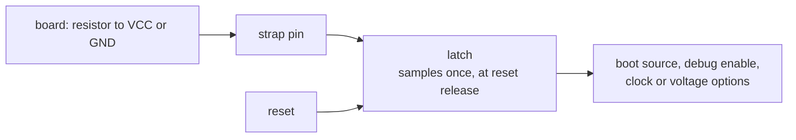
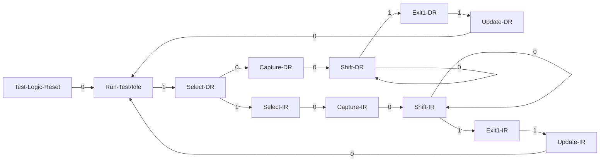
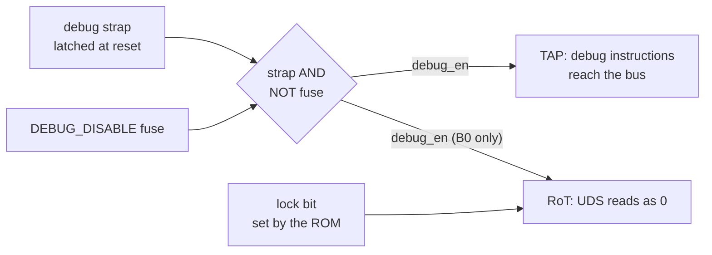

# The Back Door on the Board: Straps, JTAG and Debug Modes on a Simulated SoC

*Audience: you write or debug system software and have read [Proving What Runs](cc-attestation-blog.md), the DICE and attestation post in this series. You have heard of "boot mode pins" and "the JTAG header" but have not seen what happens inside the chip when someone uses them. We'll add strap pins, a debug-disable fuse and a JTAG port to the lab SoC, attach a probe, and steal the chip's identity. Then we'll fix the silicon so the same probe gets nothing.*

---

## 1. Two more ways in

The attestation lab trusted one path into the chip: reset, then the boot ROM, then the firmware. The verifier only talked to the firmware, through a UART.

Real boards have more pins than that. Two kinds matter for security:

- **Strap pins** decide *how* the chip boots before any code runs: from flash or from a recovery port, with the debug port open or closed.
- **JTAG** gives a probe direct access to the chip's internals while it runs. On many chips that includes the system bus, which means every register and every byte of RAM.

Engineers need both. Factories test chips through JTAG. Bring-up teams recover bricked boards through boot-mode straps. Failure-analysis labs debug returned parts. So the pins ship on production boards, often as unpopulated test pads.

An attacker with the board in hand can reach the same pins. The question for this post is: **what stops a resistor and a $20 probe from undoing the root of trust?**

---

## 2. Straps: configuration before the first instruction

A **strap** is a chip pin that the chip reads once, as it comes out of reset. The board ties each strap pin high or low with a resistor. The chip latches the value, and the latched bit configures the chip before the CPU fetches its first instruction. After reset, many strap pins become ordinary GPIO or bus pins, and their later values don't matter.



Some examples from real chips:

| Chip | Strap | What it selects |
|---|---|---|
| STM32 | `BOOT0` pin, with option bytes | Main flash, the built-in system-memory bootloader, or SRAM |
| ESP32 | `GPIO0` | Normal boot from flash, or serial download mode |
| NXP i.MX 6/8 | `BOOT_MODE[1:0]` | Boot from fuses, the serial downloader (USB/UART), or internal boot |
| Raspberry Pi RP2040 | `BOOTSEL` (QSPI chip-select held low) | Flash, or the USB mass-storage bootloader |
| Intel PCH | *Soft straps* in the SPI flash descriptor | Many platform settings, read early in boot |

Soft straps do the same job as strap pins, but they live in non-volatile storage instead of on pins.

For security, a strap is an **unauthenticated input**. Nothing signs it or measures it. Anyone who can solder a resistor, or bridge two pads with tweezers, can change it. So every strap answers one question: *what can a person do to this chip with physical access?*

Two families of straps need the most care:

- **Boot mode.** A recovery strap makes the ROM load code from USB or a UART instead of flash. That code path is attack surface. Nintendo Switch's Tegra X1 enters USB recovery mode (RCM) when a pin on the Joy-Con rail is shorted at boot, and its boot ROM had a buffer overflow in that mode (Fusée Gelée, CVE-2018-6242). Apple's checkm8 exploit attacks the boot ROM's USB DFU mode in the same way. Neither bug can be patched, because both live in ROM.
- **Debug enable.** A strap that opens the debug port gives the probe everything the debug port can reach. §3 shows how much that is.

---

## 3. JTAG: from testing solder joints to reading RAM

JTAG is the common name for IEEE 1149.1, a standard from 1990. It was designed for **boundary scan**: testing that every pin of every chip on a board is soldered, without a bed-of-nails tester. It defines a small serial port, the **Test Access Port (TAP)**, with four pins:

| Pin | Direction | Purpose |
|---|---|---|
| `TCK` | in | Test clock. Every action happens on a TCK edge. |
| `TMS` | in | Test mode select. Steers the TAP's state machine. |
| `TDI` | in | Test data in. |
| `TDO` | out | Test data out. |

An optional fifth pin, `TRST`, resets the TAP.

### The TAP state machine

The TAP is a 16-state machine driven only by `TMS`, sampled on each rising edge of `TCK`. Its job is to move bits through one of two shift registers:

- the **instruction register (IR)**, which selects what the TAP does, and
- a **data register (DR)**, which the current instruction selects.

Both registers go through the same three steps: **Capture** loads a value from the chip into the shift register, **Shift** clocks bits in on `TDI` and out on `TDO`, least significant bit first, and **Update** hands the shifted-in value to the chip.



Edge labels are the value of `TMS`. The diagram leaves out the Pause and Exit2 states and the TMS=1 exits that the lab's probe never takes. Two properties make the machine easy to drive:

- **Five clocks with `TMS` high reach Test-Logic-Reset from any state.** A probe that doesn't know the current state starts there.
- **Test-Logic-Reset selects a default instruction**, usually IDCODE. A probe can read a 32-bit identity before it knows anything else about the chip.

### IDCODE and BYPASS

The standard defines a few instructions that every TAP understands:

- **IDCODE** selects a 32-bit register: a version (bits 31–28), a part number (27–12), a JEDEC manufacturer code (11–1), and a 1 in bit 0. Probes use it to find out which chips sit on the scan chain.
- **BYPASS** selects a 1-bit register, so a chip can pass data through to the next chip on the chain with one clock of delay. The all-ones instruction is always BYPASS.
- **Capture-IR** must load a pattern that ends in binary `01`. The other bits are free, and many chips put status there.

### From test port to debug port

Chip designers soon found a second use for the TAP: **debug**. The same five pins reach a debug module inside the chip.

- On **RISC-V**, the debug spec defines a Debug Transport Module behind the TAP. It talks to a Debug Module that can halt harts, read their registers, and, with *System Bus Access*, read and write memory without halting anything.
- On **Arm**, the TAP or Serial Wire Debug (SWD) leads to a Debug Access Port. Its MEM-AP issues reads and writes on the system bus.

A debug probe with OpenOCD or GDB then becomes a **bus master**. It reaches the same address space the CPU sees, through the same interconnect. A hardware gate such as the RoT lock bit from the earlier posts still applies, because the gate sits at the register. But any secret the hardware leaves readable is readable over JTAG too.

---

## 4. Who decides whether the debug port is open?

A chip's life has phases, and debug needs differ in each:


Test and development need full debug. Production needs none. RMA needs debug again, but only for the vendor. Four mechanisms implement those rules, and real chips combine them:

| Mechanism | Who controls it | Reversible? | Weakness |
|---|---|---|---|
| **Strap pin** | Whoever holds the board | Yes, with a soldering iron | Anyone with physical access |
| **Fuse** (e.g. `DEBUG_DISABLE`) | The fab or the OEM, once | No | None for the attacker. Also no way back for RMA |
| **Lifecycle state** in OTP | The vendor, moving forward only | Only through defined transitions | Bugs in the transition logic |
| **Authenticated debug** | Whoever holds a signing key | Per session | Key management |

Lifecycle states generalize the fuse. OpenTitan, for example, moves a chip through `TEST_UNLOCKED`, `DEV`, `PROD` and `RMA` states in OTP, and each state fixes what debug may do. Authenticated debug lets the vendor reopen the port on one specific chip with a signed token, without a fuse change. Arm's PSA ADAC specification describes such a challenge-response protocol.

The rule that ties them together: **the strap may request debug, but a fuse or lifecycle state decides.** In a production part, the strap does nothing.

### The boot ROM window

There is a timing problem too. The root of trust from the earlier posts protects the UDS with a lock bit, and the *boot ROM* sets that lock. But the debug port opens at reset, before the ROM has run a single instruction. Between reset and the lock, the UDS sits behind an open door:

```
reset ──► ROM measures the firmware ──► ROM reads the UDS, sets the lock ──► ...
  ▲                                                ▲
  └──────── a probe on JTAG can read the UDS ──────┘
```

The attacker also controls reset, so the window reopens on every boot. Software can't close a window that opens before software runs. The fix has to be in hardware.

### Telling the verifier

Even when debug is legitimately open, on a development board for example, a verifier must not mistake that chip for a production chip. Two designs exist:

- **Withhold the secrets.** When debug is enabled, the hardware hides the UDS. The chip still boots, but it can't derive its production keys, so it can't pass attestation as itself. Caliptra's hardware does this: when debug is unlocked, it withholds its fuse secrets, so a debug-mode Caliptra can't reproduce its production identity.
- **Measure the mode.** Keep the UDS, but mix the debug state into the CDI and the certificate, so a debug boot gets different keys and the verifier sees the mode. Google's Open Profile for DICE does this with an explicit *mode* input: Normal, Debug, Recovery or Not Configured.

The lab implements the first design, and Exercise 2 asks you to build the second.

---

## 5. Hands-on: straps, a fuse and a JTAG probe

### 5a. What changed from the attestation lab

The lab lives in [`jtag-lab/`](jtag-lab/), a copy of the attestation lab:

```
jtag-lab/
├── Containerfile     same toolchain as the attestation lab
├── jtag_soc.py       the SoC: RoT with straps and fuses, JTAG TAP; fab, board, host and attacker roles
├── jtag_probe.py     the attacker's JTAG probe: a remote_bitbang client in Python
├── verifier.py       unchanged
└── sw/
    ├── bootrom.c     DICE boot ROM, now reports straps and supports UART boot
    ├── firmware.c    unchanged
    ├── handoff.h     unchanged
    ├── sha256.c      unchanged
    └── monocypher/   unchanged
```

The SoC is the attestation lab's chip with three additions: a JTAG TAP as a second bus master, strap pins from the board, and a `debug_en` wire from the RoT to the TAP:

![Block diagram of the lab SoC: a VexRiscv CPU and a JTAG TAP both master a Wishbone interconnect that reaches a 64 KiB boot ROM, 16 KiB SRAM, 64 KiB main RAM and a CSR space holding the Root of Trust, a UART and a timer. Off-chip, a JTAG probe drives the TAP's TCK, TMS, TDI and TDO pins, board strap resistors feed the debug and uart-boot strap pins into the Root of Trust, and an untrusted host relays messages between the UART and the verifier. A dashed debug_en wire runs from the Root of Trust to the TAP. A dashed box marks the full debug module, boundary scan and authenticated debug the lab leaves out.](images/jtag-lab-soc.drawio.svg)

*Lab SoC. Green blocks are immutable, orange ones are mutable and untrusted until attested, purple is debug access that opens only when `debug_en` is high, and red is off-chip and untrusted, the probe and the strap resistors included.*

The hardware changes:

| | Attestation lab | This lab |
|---|---|---|
| Strap pins | none | `debug`, `uart-boot` |
| OTP fuses | 256-bit UDS | 256-bit UDS + configuration word (`DEBUG_DISABLE`) |
| RoT registers | UDS, lock | UDS, lock, straps, fuses, debug |
| JTAG | none | a TAP with IDCODE, BYPASS, and debug instructions that read the bus |
| Bus masters | CPU | CPU and the TAP |

The lab also models two **silicon steppings**. A stepping is a revision of the same chip: the first tape-out is usually A0, and a fixed one B0. In this lab, A0 has a bug that B0 fixes. `--stepping` picks one, and each stepping gets its own compiled simulator in `build/gateware-A0/` or `build/gateware-B0/`.

### 5b. Straps and the debug fuse

The RoT block gains the straps, the fuse word and the logic that combines them:

```python
# Strap pins. A real board ties each one high or low with a resistor. The simulator has no board,
# so it reads the resistors from sim_straps.init at power-on: one 1-bit entry per pin.
board = Memory(1, 2, init=[straps >> i & 1 for i in range(2)], name="straps")
...
# Sample the pins once, on the first clock after reset. Whatever the pins do later is ignored.
sampled, latched = Signal(2), Signal()
self.sync += If(~latched, sampled.eq(Cat(*[pin.dat_r for pin in pins])), latched.eq(1))

# The fuse wins over the strap: once DEBUG_DISABLE is blown, no resistor can enable the port.
self.comb += self.debug_en.eq(latched & sampled[0] & ~fuse_word[0])

locked = Signal()
self.sync += If(self.lock.re & self.lock.storage[0], locked.eq(1))
hidden = locked | self.debug_en if mask_uds_in_debug else locked
self.comb += [
    ...
    self.uds.status.eq(Mux(hidden, 0, Cat(*reversed([port.dat_r for port in ports[:8]])))),
]
```

Three lines carry the security design:

- `latched` makes the strap a one-time sample. The attestation lab's lock bit used the same "sticky until reset" pattern.
- `debug_en` is the strap AND NOT the fuse. The fuse overrides the strap, in hardware.
- `hidden` is the only difference between A0 and B0. On A0, only the lock hides the UDS. On B0, `debug_en` hides it too, from reset onward, so it is hidden before the ROM runs.



The simulator has no board, so the lab keeps the strap values in a small memory that the simulator loads from `sim_straps.init` at power-on, like the OTP. Changing a strap rewrites that file. It doesn't change the RTL, so the simulator doesn't recompile.

### 5c. The TAP

`JTAGTap` in `jtag_soc.py` is about 60 lines of Migen. It implements the full 16-state controller as a table:

```python
# The 16-state TAP controller. Each entry: state -> (next if TMS=0, next if TMS=1).
next_state = {
    TLR:   (RTI,   TLR),   RTI:   (RTI,  SELDR), SELDR: (CAPDR, SELIR), CAPDR: (SHDR, EX1DR),
    SHDR:  (SHDR,  EX1DR), EX1DR: (PDR,  UPDR),  PDR:   (PDR,   EX2DR), EX2DR: (SHDR, UPDR),
    UPDR:  (RTI,   SELDR), SELIR: (CAPIR, TLR),  CAPIR: (SHIR,  EX1IR), SHIR:  (SHIR, EX1IR),
    EX1IR: (PIR,   UPIR),  PIR:   (PIR,  EX2IR), EX2IR: (SHIR,  UPIR),  UPIR:  (RTI,  SELDR),
}
```

It has a 4-bit IR and four instructions:

| Instruction | IR | DR | Available |
|---|---|---|---|
| IDCODE | `0x1` | 32 bits: `0x1D1CE0FF` | always; selected after reset |
| ADDR | `0x8` | 32 bits: bus address | only when `debug_en` |
| MEMREAD | `0x9` | 32 bits: the word at ADDR, then ADDR += 4 | only when `debug_en` |
| BYPASS | `0xF` | 1 bit | always; any unknown IR value too |

ADDR and MEMREAD are a toy version of RISC-V System Bus Access. When `debug_en` is low, they behave exactly like BYPASS, so a locked TAP looks like a chip with nothing behind it. Capture-IR loads `debug_en`, 0, 0, 1, so the probe learns the lock state the moment it scans an instruction:

```python
self.comb += [
    insn.eq(self.BYPASS),
    If(ir == self.IDCODE, insn.eq(self.IDCODE)),
    If(debug_en & ((ir == self.ADDR) | (ir == self.MEMREAD)), insn.eq(ir)),
]
...
CAPIR: ir_shift.eq(Cat(1, 0, 0, debug_en)),
...
CAPDR: [
    bypass.eq(0),
    If(insn == self.IDCODE, dr.eq(idcode)),
    If(insn == self.MEMREAD, dr.eq(data), addr.eq(addr + 4), read.eq(1)),  # prefetch next word
],
```

The TAP joins the SoC as a second Wishbone bus master next to the CPU:

```python
soc.tap = JTAGTap(platform.request("jtag"), soc.rot.debug_en, IDCODE)
soc.bus.add_master(name="jtag", master=soc.tap.bus)  # the probe reads the same bus as the CPU
```

One simplification: a real TAP uses `TCK` as its clock. This one samples `TCK` with the system clock and acts on its rising edges, which keeps the lab in one clock domain.

### 5d. The probe

LiteX's Verilator simulator includes a `jtagremote` module. It drives the chip's `TCK`, `TMS` and `TDI` pins from a TCP socket, using OpenOCD's *remote_bitbang* protocol. The protocol is one ASCII character per action: `'0'`–`'7'` set `TCK`, `TMS` and `TDI` (bits 2, 1 and 0), and `'R'` reads `TDO`. That is the whole cable.

`jtag_probe.py` speaks that protocol, and runs the attack, in about 60 lines. One clock cycle is three characters: set the pins with `TCK` low, read `TDO`, then raise `TCK`. A scan is a walk through the state machine:

```python
def scan(self, register, value, n):
    select = {"DR": 1, "IR": 2}[register]                        # TMS=1 once for Select-DR, twice for Select-IR
    bits  = [(1, 0)] * select + [(0, 0), (0, 0)]                  # -> Capture -> Shift
    bits += [(int(i == n - 1), value >> i & 1) for i in range(n)]  # shift LSB first; TMS=1 on the last bit -> Exit1
    bits += [(1, 0), (0, 0)]                                      # -> Update -> Run-Test/Idle
    out = self.clock(bits)[select + 2 : select + 2 + n]
    return sum(bit << i for i, bit in enumerate(out))

def read(self, address, nwords):
    self.scan("IR", ADDR, 4)
    self.scan("DR", address, 32)
    self.scan("IR", MEMREAD, 4)
    return [self.scan("DR", 0, 32) for _ in range(nwords)]
```

The attack is what you would try with a real probe on a real board: reset the TAP, read IDCODE, check the debug status, then read the RoT's registers. The attacker takes the register addresses from the chip's datasheet. In the lab, that is `build/csr.json`.

`jtag_soc.py` plays the roles from the attestation lab, plus two new ones:

- **board:** pulls strap pins high with `--strap debug` or `--strap uart-boot`.
- **attacker:** attaches the probe as soon as the chip has power, while the ROM is still measuring the firmware. If it gets a UDS, it derives the DeviceID key from it and compares that key with the fab's published one.

The fab can also blow the debug fuse, with `--fuse debug-disable`.

### 5e. Setup

```bash
cd jtag-lab
podman build -t jtag-lab .
alias lab='podman run --rm -it -v "$PWD":/lab:Z -w /lab jtag-lab'
```

The Containerfile is the attestation lab's. The probe needs only Python's standard library.

The host prints the probe's lines first. The chip's log waits in the pipe until the probe finishes, and then the host prints it. The `[jtag]` lines happen *during* the ROM's measurement, before the `[rom] UDS copied, RoT locked` line.

As before, your keys and nonces will differ from the ones below.

### 5f. Run 1: a production board

```bash
lab ./jtag_soc.py
```

```
[fab] B0 chip provisioned, DeviceID public key fe0528900583e2e45d8615474db7c3139bd8683ce8e69b871216cafb02a08ccf
[fab] configuration fuses blown: none
[board] strap pins pulled high: none
[vendor] reference measurement f31e21ed845a7cf24cf213aeaa61c50a3cb2faa5b2b2f314a581fa71e9203a67
[jtag] probe attached, IDCODE 0x1d1ce0ff: part 0xd1ce, version 1
[jtag] TAP status: debug access LOCKED, only IDCODE and BYPASS answer
[rom] reset vector reached, DICE boot ROM running
[rom] straps: debug=0 uart-boot=0, fuse DEBUG_DISABLE=0 -> JTAG debug access locked
[rom] firmware measurement : f31e21ed845a7cf24cf213aeaa61c50a3cb2faa5b2b2f314a581fa71e9203a67
[rom] UDS copied, RoT locked
[rom] DeviceID public key  : fe0528900583e2e45d8615474db7c3139bd8683ce8e69b871216cafb02a08ccf
[rom] Alias public key     : f0eed7c4d0658924b7d701cfb11da33535d7ff2374d89689144b8dd200a21ec7
[rom] Alias certificate signed with the DeviceID key
[rom] UDS, CDI and DeviceID private key wiped, jumping to firmware @ 0x40000000
[fw] hello from the official firmware
[fw] the ROM left me an Alias key and its certificate
[verifier] chip said HELLO, sent nonce 64e40ff029ce4184...
[verifier] got evidence, appraising:
[verifier]   ok   the DeviceID key belongs to a genuine chip (manufacturer's list)
[verifier]   ok   that chip's ROM signed the Alias certificate
[verifier]   ok   the certified measurement f31e21ed845a7cf2... is the vendor's firmware
[verifier]   ok   the report carries our nonce and is signed by the certified Alias key
[verifier] secret released, encrypted to the key in the report
[fw] unwrapped the secret: "tenant-42 disk key: open sesame!"
```

The probe gets the IDCODE: part `0xd1ce`, version 1. IDCODE always answers, which is why it's the first thing a hardware researcher reads. The status bit in Capture-IR says debug is locked, so ADDR and MEMREAD act as BYPASS. A probe that ignores the status bit and tries to read anyway gets zeros. The attestation runs as in the previous post.

### 5g. Run 2: a debug strap on A0 silicon

The attacker adds one resistor to an A0 board:

```bash
lab ./jtag_soc.py --strap debug --stepping A0
```

```
[fab] A0 chip provisioned, DeviceID public key fe0528900583e2e45d8615474db7c3139bd8683ce8e69b871216cafb02a08ccf
[fab] configuration fuses blown: none
[board] strap pins pulled high: debug
[vendor] reference measurement f31e21ed845a7cf24cf213aeaa61c50a3cb2faa5b2b2f314a581fa71e9203a67
[jtag] probe attached, IDCODE 0x1d1ce0ff: part 0xd1ce, version 1
[jtag] TAP status: debug access ENABLED, the probe can read the chip's bus
[jtag] RoT lock register: 0 (the boot ROM has not locked it yet)
[jtag] UDS read through the RoT registers: f9752c33a9ad5bef237d3f1981c06c1b1175a7d5812cb41623e40c290a1b0be4
[attacker] DeviceID derived from the stolen UDS: fe0528900583e2e45d8615474db7c3139bd8683ce8e69b871216cafb02a08ccf
[attacker] it matches the fab's published key: I can now sign anything as this chip
[rom] reset vector reached, DICE boot ROM running
[rom] straps: debug=1 uart-boot=0, fuse DEBUG_DISABLE=0 -> JTAG debug access ENABLED
[rom] firmware measurement : f31e21ed845a7cf24cf213aeaa61c50a3cb2faa5b2b2f314a581fa71e9203a67
[rom] UDS copied, RoT locked
[rom] DeviceID public key  : fe0528900583e2e45d8615474db7c3139bd8683ce8e69b871216cafb02a08ccf
...
[verifier]   ok   the DeviceID key belongs to a genuine chip (manufacturer's list)
[verifier]   ok   that chip's ROM signed the Alias certificate
[verifier]   ok   the certified measurement f31e21ed845a7cf2... is the vendor's firmware
[verifier]   ok   the report carries our nonce and is signed by the certified Alias key
[verifier] secret released, encrypted to the key in the report
[fw] unwrapped the secret: "tenant-42 disk key: open sesame!"
```

This is the boot ROM window from §4. The probe reads the RoT's lock register and gets 0, because the ROM is still hashing the firmware. Then it reads all eight UDS words through the same registers the ROM uses. The DeviceID key the attacker derives matches the one the fab published.

With the UDS, the attacker can compute this chip's DeviceID private key, and sign an Alias certificate for any measurement. Every check the verifier has will pass for a simulator that the attacker writes. The chip is cloned.

Notice what didn't help:

- **The lock bit worked.** After the ROM set it, the UDS read as zeros, for the probe too. But the probe came before the lock.
- **The attestation passed.** The verifier sees a genuine chip running official firmware, and that is true. Nothing in the evidence says a probe was attached.
- **The ROM saw the strap** and printed `debug access ENABLED`. But the ROM runs after the window opens, so it can only report the problem.

### 5h. Run 3: the same strap on B0 silicon

```bash
lab ./jtag_soc.py --strap debug
```

```
[jtag] probe attached, IDCODE 0x1d1ce0ff: part 0xd1ce, version 1
[jtag] TAP status: debug access ENABLED, the probe can read the chip's bus
[jtag] RoT lock register: 0 (the boot ROM has not locked it yet)
[jtag] UDS read through the RoT registers: 0000000000000000000000000000000000000000000000000000000000000000
[attacker] the UDS reads as zeros: nothing to steal
[rom] reset vector reached, DICE boot ROM running
[rom] straps: debug=1 uart-boot=0, fuse DEBUG_DISABLE=0 -> JTAG debug access ENABLED
[rom] firmware measurement : f31e21ed845a7cf24cf213aeaa61c50a3cb2faa5b2b2f314a581fa71e9203a67
[rom] UDS copied, RoT locked
[rom] the UDS read as zeros: the hardware hides it while debug is enabled
[rom] DeviceID public key  : b753966f71142757995a46a7675ed37d0ab5f0d513417500347170f5c869779b
[rom] Alias public key     : 0728eafa8d8ffe901a2b2c355b1a67593af83a55bd151e74f28f91922bf3a5a0
[rom] Alias certificate signed with the DeviceID key
[rom] UDS, CDI and DeviceID private key wiped, jumping to firmware @ 0x40000000
[fw] hello from the official firmware
[fw] the ROM left me an Alias key and its certificate
[verifier] chip said HELLO, sent nonce 29da9f1fccefe06f...
[verifier] got evidence, appraising:
[verifier]   FAIL the DeviceID key belongs to a genuine chip (manufacturer's list)
[verifier] secret NOT released
[fw] verifier said: DENIED evidence failed appraisal
```

The probe still has full bus access, and the lock register still reads 0. The difference is in the RoT: B0 hides the UDS whenever `debug_en` is high, from the first clock after reset. The probe gets zeros, and so does the ROM.

The chip still boots, and an engineer can still debug the firmware. But the ROM derives its keys from an all-zero UDS, so the DeviceID is `b75396…` instead of `fe0528…`. Anyone can compute that key, and it isn't on the manufacturer's list, so check 1 fails. **A debug-enabled chip is a different chip.** It can't prove the production identity, and it has no production identity to leak.

The debug state reaches the verifier without any new field in the evidence. It shows up as a DeviceID the verifier doesn't recognize.

### 5i. Run 4: a production fuse

```bash
lab ./jtag_soc.py --strap debug --fuse debug-disable
```

```
[fab] B0 chip provisioned, DeviceID public key fe0528900583e2e45d8615474db7c3139bd8683ce8e69b871216cafb02a08ccf
[fab] configuration fuses blown: debug-disable
[board] strap pins pulled high: debug
[vendor] reference measurement f31e21ed845a7cf24cf213aeaa61c50a3cb2faa5b2b2f314a581fa71e9203a67
[jtag] probe attached, IDCODE 0x1d1ce0ff: part 0xd1ce, version 1
[jtag] TAP status: debug access LOCKED, only IDCODE and BYPASS answer
[rom] reset vector reached, DICE boot ROM running
[rom] straps: debug=1 uart-boot=0, fuse DEBUG_DISABLE=1 -> JTAG debug access locked
...
[verifier]   ok   the report carries our nonce and is signed by the certified Alias key
[verifier] secret released, encrypted to the key in the report
[fw] unwrapped the secret: "tenant-42 disk key: open sesame!"
```

The strap is still high, and the ROM reports it. But the fab blew `DEBUG_DISABLE`, so `debug_en` stays low. The TAP is locked, the UDS is available, and the chip attests as itself. This is what a production part looks like: the strap requests debug, and the fuse refuses it.

### 5j. Run 5: boot mode

The second strap changes where the firmware comes from. With `uart-boot`, flash (main RAM in the lab) is blank, and the ROM asks the host for the image over the UART:

```c
/* Recovery boot: ask the host for the firmware, one line of hex at a time, until it sends an empty line.
 * The ROM checks nothing here. The measurement in step 1 covers whatever arrives. */
static void load_from_uart(void)
```

The comment is the design. A recovery path doesn't need its own security check, as long as it comes *before* the measurement and the DICE derivation. Feed it the official firmware and the chip attests as normal:

```bash
lab ./jtag_soc.py --strap uart-boot
```

```
[rom] straps: debug=0 uart-boot=1, fuse DEBUG_DISABLE=0 -> JTAG debug access locked
[rom] loaded 26624 bytes of firmware from the UART
[rom] firmware measurement : f31e21ed845a7cf24cf213aeaa61c50a3cb2faa5b2b2f314a581fa71e9203a67
...
[verifier] secret released, encrypted to the key in the report
```

Feed it the evil firmware:

```bash
lab ./jtag_soc.py --strap uart-boot --tamper
```

```
[attacker] patched firmware, it now measures f9958c81a0959a87a0eaa02c525d4cc60b08c0ef016f82055503547685ecdc8c
[jtag] probe attached, IDCODE 0x1d1ce0ff: part 0xd1ce, version 1
[jtag] TAP status: debug access LOCKED, only IDCODE and BYPASS answer
[rom] reset vector reached, DICE boot ROM running
[rom] straps: debug=0 uart-boot=1, fuse DEBUG_DISABLE=0 -> JTAG debug access locked
[rom] loaded 26624 bytes of firmware from the UART
[rom] firmware measurement : f9958c81a0959a87a0eaa02c525d4cc60b08c0ef016f82055503547685ecdc8c
[rom] UDS copied, RoT locked
[rom] DeviceID public key  : fe0528900583e2e45d8615474db7c3139bd8683ce8e69b871216cafb02a08ccf
[rom] Alias public key     : d35cfacaa376c0ea8f8e17ba34075ea66372b5176a5ea849626661580adc8f88
...
[fw] hello from the EVIL  firmware!!!
...
[verifier]   FAIL the certified measurement f9958c81a0959a87... is the vendor's firmware
[verifier] secret NOT released
[fw] verifier said: DENIED evidence failed appraisal
```

The result is the same as `--tamper` from flash in the previous post. The boot mode changed where the bytes came from, not whether they were measured. Fusée Gelée and checkm8 are a warning about the other half: the loader itself runs in the ROM, before any measurement, so a bug in the loader runs code that nothing measures. This lab's loader is 20 lines and only writes inside the firmware partition. Real recovery modes speak USB, which is harder to get right.

---

## 6. What this lab leaves out

- **A real debug module.** The lab's TAP can only read the bus. A RISC-V Debug Module or an Arm DAP can also write memory, halt the CPU, set breakpoints and single-step. A probe that can write can also patch the firmware *after* the ROM measured it, which no measurement catches.
- **TCK as a clock.** Real TAPs run in their own `TCK` clock domain and cross into the system clock domain through synchronizers. The lab samples `TCK` with the system clock.
- **Boundary scan.** The lab has no `EXTEST` or `SAMPLE/PRELOAD`, the instructions JTAG was created for. On real chips, boundary scan can also drive pins, and the debug-lock logic must cover it.
- **Scan chains with several TAPs.** Real boards chain several chips' TAPs, and SoCs often chain several TAPs inside one die. Each one is a door.
- **Lifecycle states and authenticated debug.** The lab has one fuse. Production chips use a lifecycle state machine in OTP, and a signed-token protocol to reopen debug for RMA.
- **Physical attacks on the strap sample.** The latch samples the pins once. An attacker who glitches the supply or the clock at that moment may change what the latch sees. Chips defend with filtered and repeated sampling, and with fuses that make the strap irrelevant.
- **SWD, and pins shared with GPIO.** Many chips use 2-wire SWD instead of JTAG, or share the debug pins with GPIO. Tools such as the JTAGulator find them on unknown boards by brute force.

---

## 7. Exercises

1. **Reopen the window.** Add a TAP instruction that pulses the SoC's reset, as many real TAPs can. On A0, read the UDS after the ROM has locked it (zeros), then reset the chip through JTAG and read it again. What does this say about "lock until reset" when the attacker controls reset?
2. **Measure the mode instead.** Change B0 so the UDS stays visible in debug, but the ROM mixes the debug state into the CDI and puts a mode byte in the Alias certificate, as in Open Profile for DICE. Extend the verifier to require normal mode. Which design survives Exercise 1, and why?
3. **Remove the latch.** Make `debug_en` follow the strap pin directly instead of the latched value. Which assumption in the ROM breaks? Think about a pin that changes after the ROM printed `JTAG debug access locked`.
4. **Authenticated debug.** Add a TAP instruction that takes a 64-byte Ed25519 signature over the chip's DeviceID public key, and opens debug access only if a vendor key signed it. Where does the vendor's public key live, and what must the hardware do to the UDS while that debug session is open?
5. **Use real tools.** Install OpenOCD, point its `remote_bitbang` adapter at port 44853, and declare a TAP with `-irlen 4 -expected-id 0x1d1ce0ff`. Then use `irscan` and `drscan` to read the IDCODE and the UDS by hand.
