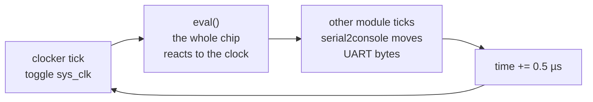

# A LiteX Primer for the SoC and Confidential Computing Series

*Audience: you're reading or about to read the series that starts with [Where Trust Begins](soc-root-of-trust-blog.md). Every lab in it builds a small SoC with [LiteX](https://github.com/enjoy-digital/litex) and runs it in a simulator. This primer collects in one place the LiteX concepts the labs use: Migen modules, CSRs, the platform, `SoCCore`, the `Builder`, the simulator, and how custom firmware gets built and loaded. It also explains how the labs relate to the usual LiteX workflows, litex-boards and the command-line tools, which LiteX's own documentation leads with.*

---

## 1. What is LiteX?

LiteX is a Python framework for building SoCs. You describe the hardware in Python, LiteX generates Verilog, and a backend turns that Verilog into an FPGA bitstream or a simulator. It has several layers:

| Layer | What it gives you | Used in the series as |
|---|---|---|
| **Migen** | a hardware description language embedded in Python: signals, logic, registers, memories | the Root of Trust block |
| **LiteX cores** | ready-made hardware: CPU wrappers (VexRiscv and others), Wishbone and CSR buses, UART, timer, RAM and ROM | the CPU, buses, memories, UART |
| **SoC builder** | `SoCCore` assembles cores into an SoC with a memory map; `Builder` generates everything | `make_soc()` in each lab |
| **Build backends** | Verilator for simulation; Vivado, Yosys/nextpnr and others for FPGAs | Verilator only |
| **Software** | a BIOS, `libbase` (drivers), picolibc, CPU start-up code, linker scripts, generated headers | the boot ROM and firmware build |

Around that core sit the ecosystem projects: LiteDRAM, LiteEth, LiteSPI, LiteSDCard and more ([Cores-Ecosystem](https://github.com/enjoy-digital/litex/wiki/Cores-Ecosystem)). [litex-boards](https://github.com/litex-hub/litex-boards) adds platform and target files for hundreds of FPGA boards.

---

## 2. Three ways to use LiteX

| Way | Example | Good for |
|---|---|---|
| **The CLI tools** | `litex_sim --cpu-type=vexriscv` | trying LiteX: a ready-made SoC with a BIOS prompt, configured by flags |
| **A litex-boards target** | `python3 -m litex_boards.targets.digilent_arty --build --load` | running a standard SoC on a real FPGA board |
| **Your own SoC script** | `rot_soc.py`, `cc_soc.py`, `trustee_soc.py`, `tls_soc.py` | custom hardware, custom boot flow |

The LiteX documentation primarily focuses on the first two ways. The series uses the third, for three reasons:

- It adds a **custom peripheral**, the Root of Trust block, which no CLI flag provides.
- It replaces the **LiteX BIOS** with its own boot ROM, because the ROM is the subject of the series.
- It drives the simulator from Python, to play the fab, the vendor, the attacker and the host around the chip.

The three ways share one structure. `litex_sim` is a Python script (`litex/tools/litex_sim.py`) that builds a `SimSoC` class with `SoCCore` and runs `Builder`. A litex-boards target, such as `litex_boards/targets/digilent_arty.py`, follows the same pattern with a real board's platform. The lab scripts are smaller versions of that pattern, so reading `litex_sim.py` after the labs is a good way to see what else LiteX can do.

A quick look at the stock simulator, before you build your own:

```bash
litex_sim --cpu-type=vexriscv           # builds and boots a SoC with the LiteX BIOS
litex_sim --cpu-type=vexriscv --help    # every option: Ethernet, SDRAM, tracing, ...
```

---

## 3. What is Migen?

Hardware is a set of signals and the rules that drive them. Migen expresses both in Python:

```python
from migen import *
from litex.gen import LiteXModule

class Blinky(LiteXModule):
    def __init__(self):
        self.led = Signal()           # one bit of hardware state or wire
        counter  = Signal(24)         # 24 bits
        self.sync += counter.eq(counter + 1)          # flip-flops: update on every clock edge
        self.comb += self.led.eq(counter[23])         # logic: holds at all times
```

The pieces the series uses:

- **`Signal(n)`**: an n-bit wire or register.
- **`self.comb += …`**: combinational logic. The assignment holds continuously, like a wire.
- **`self.sync += …`**: synchronous logic. The assignment happens on each clock edge, so the target becomes a flip-flop.
- **`If(cond, …).Elif(…).Else(…)`**: conditional assignments. In `sync`, a condition decides whether a flip-flop takes a new value.
- **`Mux(sel, a, b)`**: a multiplexer, `a` when `sel` is 1. The Root of Trust uses `Mux(locked, 0, fuse)` to cut the fuses off the bus.
- **`Cat(a, b, …)`**: concatenation, first argument in the lowest bits.
- **`Memory(width, depth, init=…)`**: a RAM or ROM array. `get_port()` gives a read or write port, and LiteX writes the `init` contents to an `.init` file.

**`LiteXModule` versus Migen's `Module`.** Both describe a block of hardware. `LiteXModule` adds automatic registration: assigning a module to an attribute (`self.rot = RootOfTrust(…)`) adds it as a submodule. It also collects the block's CSRs (`AutoCSR`) and documentation (`AutoDoc`). With plain Migen you'd write `self.submodules.rot = …`. New LiteX code uses `LiteXModule`.

For details, refer to the Migen [manual](https://m-labs.hk/migen/manual/).

---

## 4. CSRs: how software talks to the hardware

A **CSR** (Control and Status Register) is a register that the CPU reads or writes at a fixed address. LiteX gives you three kinds:

| Class | Hardware side | CPU side | In the series |
|---|---|---|---|
| `CSRStatus(n)` | drives `.status` | reads | `fuse_digest`, `locked`, `uds` |
| `CSRStorage(n)` | reads `.storage`; `.re` pulses for one cycle on each CPU write | writes, reads back | `lock`, `meas_stage` |
| `CSR(n)` | sees `.r` and `.re` (write strobe), drives `.w` | writes and reads, no storage | `sim_finish` |

Here is the Root of Trust block that we'll use, minus its fuses:

```python
class RootOfTrust(LiteXModule):
    def __init__(self):
        self.lock   = CSRStorage(1)
        self.locked = CSRStatus(1)

        locked = Signal()
        self.sync += If(self.lock.re & self.lock.storage[0], locked.eq(1))   # sticky until reset
        self.comb += self.locked.status.eq(locked)
```

Four things are taken care by LiteX:

1. **Collection.** `LiteXModule` finds every CSR attribute in the block.
2. **Addressing.** The SoC gives each block a 2 KiB slot (`csr_paging = 0x800`) in the CSR region, and each register its offset inside the slot. Registers wider than 32 bits take several words, most significant word first (`csr_ordering = "big"`).
3. **Bus logic.** LiteX bridges the CPU's Wishbone bus to a simple CSR bus and generates the decoding.
4. **Headers.** The build writes `csr.h` with an address and accessor functions for every register:

```c
#define CSR_ROT_LOCK_ADDR (CSR_BASE + 0x868L)
static inline void rot_lock_write(uint32_t v) { csr_write_simple(v, CSR_BASE + 0x868L); }
static inline uint32_t rot_locked_read(void) { return csr_read_simple(CSR_BASE + 0x86cL); }
```

The names follow `<block>_<register>`, from the attribute names in Python. For registers wider than 64 bits, LiteX generates only the address, and the firmware reads word by word with `csr_read_simple(addr + 4 * i)`. The [CSR Bus](https://github.com/enjoy-digital/litex/wiki/CSR-Bus) page has the details.

---

## 5. Platform and `SoCCore`

### 5a. The platform: what the chip connects to

A **platform** describes the outside world: pins, clocks and connectors. For an FPGA board it lists real pins. For the simulator it lists signals that the simulator's modules drive:

```python
from litex.build.generic_platform import Pins, Subsignal
from litex.build.sim import SimPlatform
from litex.build.io import CRG

_io = [
    ("sys_clk", 0, Pins(1)),
    ("sys_rst", 0, Pins(1)),
    ("serial", 0,
        Subsignal("source_valid", Pins(1)), Subsignal("source_ready", Pins(1)), Subsignal("source_data", Pins(8)),
        Subsignal("sink_valid",   Pins(1)), Subsignal("sink_ready",   Pins(1)), Subsignal("sink_data",   Pins(8)),
    ),
]
platform = SimPlatform("SIM", _io)
```

`platform.request("sys_clk")` hands one of these resources to the design.

Every `self.sync` assignment belongs to a **clock domain**, a clock plus its reset. Plain `self.sync` uses the domain named `sys`, whose two signals, `cd_sys.clk` and `cd_sys.rst`, decide when each flip-flop updates and when it returns to its reset value. A **CRG** (clock and reset generator) drives those signals:

- **On an FPGA board**, the CRG turns the board's oscillator into the frequencies the SoC wants, with the FPGA's PLL, and holds the domains in reset until the PLL locks. That's why each litex-boards target has its own `_CRG` class.
- **In the simulator**, the `clocker` module already toggles the `sys_clk` pad at the configured frequency. The simple `CRG` from `litex.build.io` wires that pad straight to `cd_sys.clk` and adds a power-on reset: `sys` starts in reset and comes out after the first clock edge (§7e).
    
### 5b. `SoCCore`: the standard SoC

`SoCCore` builds a complete SoC from a few arguments. All four labs use the same call, with different sizes:

```python
from litex.soc.integration.soc_core import SoCCore

soc = SoCCore(platform, clk_freq=int(1e6),
    cpu_type                 = "vexriscv",       # a 32-bit RISC-V core
    uart_name                = "sim",            # a UART connected to the simulator's "serial" pads
    integrated_rom_size      = 0x10000,          # on-chip ROM; the CPU starts here
    integrated_rom_init      = rom_words,        # 32-bit words; empty means "put the LiteX BIOS here"
    integrated_sram_size     = 0x4000,           # on-chip RAM for stack and data
    integrated_main_ram_size = 0x10000,          # a bigger RAM; the labs load firmware into it
    integrated_main_ram_init = firmware_words,
)
soc.crg = CRG(platform.request("sys_clk"))
soc.rot = RootOfTrust()                          # a custom peripheral: assign it as an attribute
```

This gives you the CPU, a Wishbone interconnect, the three memories, a UART, a timer, a control block (`ctrl`) and the CSR bridge. The CPU defines the memory map. For VexRiscv it's ROM at `0x0000_0000`, SRAM at `0x1000_0000`, main RAM at `0x4000_0000` and CSRs at `0xF000_0000`, and the build writes it to `mem.h`.

Other calls used in the series:

- **`soc.add_uart(name, uart_name, uart_pads)`** adds another UART. (The simulator's bridges only handle pads named `serial`, though, so the labs stayed with one UART.)
- **`platform.add_debug(soc)`** adds three simulation helpers as CSRs: `sim_finish` (the firmware stops the simulation), `sim_trace` (turns waveform recording on and off) and `sim_marker`.
- **The timer** comes with `SoCCore`. The labs don't use it, but `libbase` needs `timer0` for `busy_wait()`, so `with_timer=False` breaks the software build.

The [SoC Simulator](https://github.com/enjoy-digital/litex/wiki/SoC-Simulator) and [CPUs](https://github.com/enjoy-digital/litex/wiki/CPUs) wiki pages list the alternatives: other CPUs, SDRAM models, Ethernet, video.

---

## 6. `Builder`: from Python to a running chip

`Builder` turns the SoC into files and, for the simulator, a running process:

```python
from litex.build.sim.config import SimConfig
from litex.soc.integration.builder import Builder

sim_config = SimConfig()
sim_config.add_clocker("sys_clk", freq_hz=int(1e6))
sim_config.add_module("serial2console", "serial")     # UART <-> the simulator's stdin/stdout

Builder(soc, output_dir="build").build(sim_config=sim_config)
```

It produces this tree:

```
build/
├── gateware/
│   ├── sim.v                    the whole SoC in Verilog
│   ├── sim_rom.init, sim_main_ram.init, sim_otp.init   memory contents, read at power-on
│   └── obj_dir/Vsim             the Verilator simulator, after compilation
└── software/
    ├── include/generated/       csr.h, mem.h, soc.h, regions.ld, variables.mak, ...
    ├── libc/, libbase/, libcompiler_rt/   libraries for your firmware
    └── bios/                    the LiteX BIOS, if the ROM is empty
```

`build()` takes switches the labs rely on:

| Argument | Effect |
|---|---|
| `Builder(..., compile_gateware=False)` | only generate headers and build the software libraries; no Verilog compile |
| `build(run=False)` | generate everything but don't start the simulator (see the gotcha in §9) |
| `build(trace=True)` | build the simulator with waveform support (VCD, or FST with `trace_fst=True`) |
| `build(interactive=False)` | don't put your terminal in raw mode |

**The two-pass build.** Firmware needs `csr.h` and `mem.h`, and those come from the SoC. The ROM's contents are part of the SoC too. So each lab builds twice:

1. Build the SoC with empty memories and `compile_gateware=False`. This produces the headers and libraries.
2. Compile the boot ROM and firmware against them.
3. Build the SoC again with the compiled images as `integrated_rom_init` and `integrated_main_ram_init`, then run it.

The second pass doesn't change the hardware, so the addresses from pass 1 stay valid.

**The BIOS.** When the ROM is empty, `Builder` compiles the LiteX BIOS and puts it there. The BIOS is a small monitor that can boot software from the serial port, flash, SD card or Ethernet. The labs replace it with their own boot ROM. In pass 1, setting `soc.integrated_rom_initialized = True` tells `Builder` not to build the BIOS.

---

## 7. What a run prints, from `INFO:SoC` to the reset vector

A lab run prints three kinds of lines before the boot ROM says anything. They come from three different programs, at three different times.

| Stage | Printed by | Example | What happens |
|---|---|---|---|
| 1. Elaborate | Python (`SoCCore`, `Builder`) | `INFO:SoC:CPU vexriscv setting reset address to 0x00000000.` | LiteX assembles the SoC and writes `sim.v`, the `.init` files and the headers |
| 2. Compile | `make`, Verilator, the C compiler | `verilator -Wno-fatal -O3 --cc …` (or `[build] RTL unchanged…`) | `sim.v` becomes `obj_dir/Vsim`; each simulation module becomes a `.so` |
| 3. Start the simulator | `Vsim` and its modules | `[gmii_ethernet] loaded`, `[clocker] sys_clk: freq_hz=1000000` | modules load, `sim_config.js` picks the ones to attach |
| 4. Power on | the simulated chip | `[rom] reset vector reached` | memories fill from `.init` files, reset releases, the CPU fetches from `0x0` |

### 7a. `INFO:SoC`: Python builds the SoC

The `INFO:SoC…` lines are a transcript of `SoCCore` assembling the chip. Reading them is the quickest way to check what you built:

```
INFO:SoCCSRHandler:32-bit CSR Bus, 32-bit Aligned, 16.0KiB Address Space, 2048B Paging, big Ordering (Up to 32 Locations).
INFO:SoC:CPU vexriscv overriding sram mapping from 0x01000000 to 0x10000000.
INFO:SoC:CPU vexriscv setting reset address to 0x00000000.
INFO:SoC:RAM rom added Origin: 0x00000000, Size: 0x00010000, Mode:  RX, Cached:  True, Linker: False.
INFO:SoC:RAM main_ram added Origin: 0x40000000, Size: 0x00010000, Mode: RWX, Cached:  True, Linker: False.
INFO:SoCCSRHandler:rot CSR allocated at Location 1.
INFO:SoCCSRHandler:uart CSR allocated at Location 6.
```

Each line matches a concept from earlier in this primer. The CSR handler sets the 2 KiB slots and the word order from §4. VexRiscv moves SRAM to its own address and sets its reset address to the ROM, as §5b says. `rot CSR allocated at Location 1` means the Root of Trust gets slot 1, so its registers start at `0xF000_0000 + 1 × 0x800 = 0xF000_0800`. The run prints these lines twice, once for each pass of the two-pass build.

### 7b. Compiling: one simulator, many modules

`Vsim` has two parts:

- **The chip.** Verilator translates `sim.v` and the CPU's Verilog (`VexRiscv.v`) into C++ and compiles them. Everything inside the SoC lives here.
- **The simulator core.** A small C program from `litex/build/sim/core/` (`sim.c`, `veril.cpp`, `pads.c`) runs the clock loop and connects the chip's pads to plug-in modules.

The modules are the outside world: a clock source, a console, Ethernet, an I2C EEPROM, a JTAG port, a QEMU bridge. Each is a directory in `litex/build/sim/core/modules/`, and the build compiles *all* of them into `build/gateware/modules/*.so`, whether your SoC uses them or not.

### 7c. `[module] loaded`: the simulator starts

When `Vsim` starts, it opens every `.so` in `modules/` with `dlopen`, and each module prints that it loaded:

```
[gmii_ethernet] loaded (0x55841fa7c2f0)
[qemu_axi] loaded (0x55841fa7c2f0)
[serial2console] loaded (0x55841fa7c2f0)
[spdeeprom] loaded (addr = 0x0)
[clocker] loaded
...
[clocker] sys_clk: freq_hz=1000000, phase_deg=0
```

So `[gmii_ethernet] loaded` means the code is in memory, not that the chip has an Ethernet port. Next, `Vsim` reads `sim_config.js`, which `SimConfig` wrote from your script, and creates a session only for the modules listed there. In the labs that's two:

```json
{
    "module": "clocker",
    "interface": [
        "sys_clk"
    ],
    "args": {
        "freq_hz": 1000000,
        "phase_deg": 0
    },
    "tickfirst": true
},
{
    "module": "serial2console",
    "interface": [
        "serial",
        "sys_clk"
    ]
},
{
    "timebase": 500000
}

```

Each `interface` name pads from the platform's `_io` list. `clocker` drives `sys_clk`. `serial2console` connects the UART's `serial` pads to the simulator's stdin and stdout, which is how `printf` in the firmware reaches your terminal, and how the host talks to the chip. The `[clocker] sys_clk: …` line comes from creating the clocker's session.

### 7d. The run loop

The simulator advances time in steps of `timebase`, 500,000 ps here, which is half a period of the 1 MHz clock:



`eval()` is the Verilated chip. On a rising clock edge, every `self.sync` assignment in every block takes effect, and every `self.comb` assignment settles. The loop stops when the firmware writes `sim_finish`. That write prints the closing `[sim] sys_clk=1.000MHz, simulated=…, elapsed=…` line, which shows how fast the simulation ran compared with real time.

### 7e. Power-on: from reset to `[rom] reset vector reached`

Nothing loads software into the chip at run time. The memories are full before the first clock edge:

1. **Memory contents.** `sim.v` declares each memory with an `initial` block that calls `$readmemh("sim_rom.init", rom)`, and the same for `sim_main_ram.init`, `sim_sram.init` and `sim_otp.init`. Verilator runs those blocks when the model starts, so the boot ROM, the firmware and the fuses are in place at time zero.
2. **Reset.** The CRG holds the `sys` clock domain in reset at power-on and releases it after the first clock edge.
3. **The first fetch.** VexRiscv leaves reset at its reset address, `0x0000_0000` (the `setting reset address` line from §7a). That address belongs to the ROM, so the first instruction it runs is the boot ROM's `crt0`, which sets up the stack and calls `main()`.
4. **The first output.** `main()` calls `uart_init()` and `printf()`. Each byte goes through the UART's registers to its pads, `serial2console` picks it up on the next tick, and `[rom] reset vector reached` appears on your terminal.

---

## 8. Your own firmware

### 8a. The build

LiteX's generated `variables.mak` and its `common.mak` give your firmware's Makefile the compiler, flags, include paths and library list for the SoC you built:

```make
BUILD_DIR?=../build
include $(BUILD_DIR)/software/include/generated/variables.mak
include $(SOC_DIRECTORY)/software/common.mak

VPATH = $(CPU_DIRECTORY)                 # crt0.S: the CPU's start-up code

LINK = $(CC) $(LDFLAGS) -N -o $@ $^ $(PACKAGES:%=-L$(BUILD_DIR)/software/%) \
       -Wl,--start-group $(LIBS:lib%=-l%) -Wl,--end-group -Wl,--gc-sections

bootrom.elf: crt0.o bootrom.o
	$(LINK) -T $(BIOS_DIRECTORY)/linker.ld                 # code in ROM, data and stack in SRAM
firmware.elf: crt0.o firmware.o
	$(LINK) -T $(SOC_DIRECTORY)/software/demo/linker.ld    # everything in main RAM

%.bin: %.elf
	$(OBJCOPY) -O binary $< $@
%.o: %.c
	$(compile)
%.o: %.S
	$(assemble)
```

The two linker scripts come with LiteX. The BIOS one suits code that runs from ROM. The demo one suits an application in main RAM. `crt0.S` sets up the stack, copies initialized data, clears `.bss` and calls `main()`.

### 8b. The code

```c
#include <generated/csr.h>     /* register addresses and accessors */
#include <generated/mem.h>     /* ROM_BASE, SRAM_BASE, MAIN_RAM_BASE, ... */
#include <libbase/uart.h>
#include <stdio.h>

int main(void)
{
    uart_init();
    printf("hello\n");                   /* printf goes to the UART */
    rot_lock_write(1);                   /* a generated CSR accessor */
    sim_finish_finish_write(1);          /* stop the simulator */
    return 0;
}
```

LiteX's C library is small so you'll have to write some custom helpers as per your requirements. `system.h` adds `flush_cpu_icache()`, which a boot ROM must call before it jumps to code it has loaded or measured.

### 8c. Getting firmware into the chip

| Way | How | Used by |
|---|---|---|
| ROM contents | `integrated_rom_init=` at build time | the labs' boot ROMs |
| RAM contents | `integrated_main_ram_init=` at build time (simulation) | the labs' firmware: "a loader already put it in RAM" |
| BIOS serial boot | `litex_term /dev/ttyUSB0 --kernel=app.bin` uploads to `0x4000_0000` and jumps | the normal way on an FPGA board |
| BIOS from flash, SD card or Ethernet | BIOS boot commands | Linux and other larger systems |

For a starting point, `litex_bare_metal_demo --build-path=build/<target>` creates a demo application with a Makefile like the one above. The [Load Application Code To CPU](https://github.com/enjoy-digital/litex/wiki/Load-Application-Code-To-CPU) page walks through the BIOS options.

---

## 9. Gotchas the series ran into

| Symptom | Cause | Fix used in the labs |
|---|---|---|
| Changes to the hardware don't take effect | `build(run=False)` skips compiling the simulator | call the compile step yourself, then run `obj_dir/Vsim` |
| Every run recompiles the simulator | LiteX re-runs Verilator on every build, and `sim.v` contains timestamps | hash `sim.v` without comments; skip the compile when the hash matches |
| Memory or fuse contents need a rebuild | values written as constants in the logic | put them in a `Memory`; LiteX loads `.init` files at start-up |
| Building without the timer fails | `libbase` uses `timer0` | keep the timer |
| Pass 1 builds a BIOS you don't want | an empty ROM means "use the BIOS" | `soc.integrated_rom_initialized = True` |
| A second UART can't reach the simulator | `serial2console` and `serial2tcp` only accept pads named `serial` | one UART, with the host telling log lines from protocol lines |
| Input sent to the chip gets corrupted | the console bridge buffers 2 KiB of input | the chip asks for each chunk (`TCP MORE`) |
| The first byte sent at boot disappears | `uart_init()` clears a pending byte | the firmware says `HELLO` before the host sends |
| FST waveforms won't open | Verilator and GTKWave versions disagree on FST | record VCD instead |

---

## 10. Where this primer fits in the series

| Post | LiteX features it adds |
|---|---|
| [1. Where Trust Begins](soc-root-of-trust-blog.md) | `SoCCore` with a custom CSR block, custom boot ROM, two-pass build, `Memory` for fuses, `sim_trace` |
| [2. Proving What Runs](cc-attestation-blog.md) | bigger ROM, firmware linked against vendored C libraries, simulator driven through pipes |
| [3. Teaching Trustee a New TEE](trustee-attestation-blog.md) | firmware with two crypto libraries, larger memories, a host process next to the simulator |
| [4. Taking the Host Out of the Protocol](tls-attestation-blog.md) | a TLS client in firmware, flow control over the simulated UART |

---

## 11. References

**LiteX**
- [LiteX repository](https://github.com/enjoy-digital/litex) and [wiki home](https://github.com/enjoy-digital/litex/wiki/Home)
- [Installation](https://github.com/enjoy-digital/litex/wiki/Installation): `litex_setup.py`, toolchains
- [Tutorials and resources](https://github.com/enjoy-digital/litex/wiki/Tutorials-Resources): talks, courses and examples
- [SoC Simulator](https://github.com/enjoy-digital/litex/wiki/SoC-Simulator): `litex_sim` and its options
- [CSR Bus](https://github.com/enjoy-digital/litex/wiki/CSR-Bus) and [Wishbone Bus](https://github.com/enjoy-digital/litex/wiki/Wishbone-Bus)
- [CPUs](https://github.com/enjoy-digital/litex/wiki/CPUs): the CPU cores LiteX supports
- [Load Application Code To CPU](https://github.com/enjoy-digital/litex/wiki/Load-Application-Code-To-CPU): BIOS boot options, `litex_term`
- [Use Host Bridge to control/debug a SoC](https://github.com/enjoy-digital/litex/wiki/Use-Host-Bridge-to-control-debug-a-SoC): `litex_server` and `litex_cli`, to read and write CSRs from a host
- [Reuse a (System)Verilog, VHDL, Amaranth, Spinal HDL, Chisel core](https://github.com/enjoy-digital/litex/wiki/Reuse-a-(System)Verilog,-VHDL,-Amaranth,-Spinal-HDL,-Chisel-core): bringing in hardware written elsewhere
- [Run Linux on your SoC](https://github.com/enjoy-digital/litex/wiki/Run-Linux-On-Your-SoC) and [linux-on-litex-vexriscv](https://github.com/litex-hub/linux-on-litex-vexriscv)
- `litex/tools/litex_sim.py` and `litex/soc/software/demo/` in the repository: worked examples of a simulated SoC and a firmware build

**Boards and tutorials**
- [litex-boards](https://github.com/litex-hub/litex-boards): platform and target files for real FPGA boards
- [fpga_101](https://github.com/litex-hub/fpga_101): hands-on FPGA lessons with Migen and LiteX

**Underneath**
- [Migen manual](https://m-labs.hk/migen/manual/) and the wiki's [Migen-Amaranth](https://github.com/enjoy-digital/litex/wiki/Migen-Amaranth) page
- [VexRiscv](https://github.com/SpinalHDL/VexRiscv): the CPU core used in the labs
- [Verilator](https://www.veripool.org/verilator/): the simulator backend
