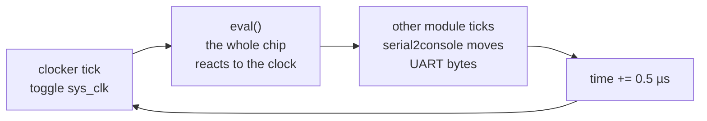

# A LiteX Primer for the SoC and Confidential Computing Series

This primer is for readers of my upcoming SoC and Confidential Computing series. Each lab in the series builds a small SoC using [LiteX](https://github.com/enjoy-digital/litex)  and runs it in simulation. Here, you’ll find concise explanations of the LiteX concepts used throughout the labs, such as Migen modules, CSRs, the platform, SoCCore, Builder, and the simulator, as well as how to build and load custom firmware. The primer also clarifies how the labs’ workflow relates to standard LiteX practices like litex-boards and the official command-line tools.

---

## What is LiteX?

LiteX is a Python framework for designing system-on-chips (SoCs). You describe the hardware in Python, and LiteX generates Verilog code from Python. You can use the generated Verilog code to build an FPGA bitstream or run a simulation. 

LiteX consists of the following main layers:


| Layer | What it gives you | Used in the series as |
|---|---|---|
| **Migen** | a hardware description language embedded in Python: signals, logic, registers, memories | the Root of Trust block |
| **LiteX cores** | ready-made hardware: CPU wrappers (VexRiscv and others), Wishbone and CSR buses, UART, timer, RAM and ROM | the CPU, buses, memories, UART |
| **SoC builder** | `SoCCore` assembles cores into an SoC with a memory map; `Builder` generates everything | `make_soc()` in each lab |
| **Build backends** | Verilator for simulation; Vivado, Yosys/nextpnr and others for FPGAs | Verilator only |
| **Software** | a BIOS, `libbase` (drivers), picolibc, CPU start-up code, linker scripts, generated headers | the boot ROM and firmware build |

Then there are ecosystem projects like: LiteDRAM, LiteEth, LiteSPI, LiteSDCard and more ([Cores-Ecosystem](https://github.com/enjoy-digital/litex/wiki/Cores-Ecosystem)). [litex-boards](https://github.com/litex-hub/litex-boards) adds platform and target files for hundreds of FPGA boards.

---

## Three ways to use LiteX

| Way | Example | Good for |
|---|---|---|
| **The CLI tools** | `litex_sim --cpu-type=vexriscv` | trying LiteX: a ready-made SoC with a BIOS prompt, configured by flags |
| **A litex-boards target** | `python3 -m litex_boards.targets.digilent_arty --build --load` | running a standard SoC on a real FPGA board |
| **Your own SoC script** | `rot_soc.py`, `cc_soc.py`, `trustee_soc.py`, `tls_soc.py` | custom hardware, custom boot flow |

The LiteX documentation primarily focuses on the first two ways. The series uses the third, for the following reasons:

* It adds a custom peripheral, the Root of Trust block, which no CLI flag provides.
* It replaces the LiteX BIOS with its own boot ROM, because the ROM is the subject of the series.
* It drives the simulator from Python to play the fab, the vendor, the attacker and the host around the chip.

The core pattern is the same. The `litex_sim` is a python script (`litex/tools/litex_sim.py`) that builds a SimSoC class with SoCCore and runs Builder. A litex-boards target, such as `litex_boards/targets/digilent_arty.py`, follows the same pattern with a real board’s platform.
The lab scripts are smaller versions of that pattern, so reading litex_sim.py after the labs is a good way to see what else LiteX can do.

A quick look at the stock simulator, before you build your own:

```bash
litex_sim --cpu-type=vexriscv           # builds and boots a SoC with the LiteX BIOS
litex_sim --cpu-type=vexriscv --help    # every option: Ethernet, SDRAM, tracing, ...
```

---

## What is Migen?

Hardware is a set of signals and the rules that drive them. Migen expresses both in Python:

```python
from migen import *
from litex.gen import LiteXModule

class Blinky(LiteXModule):
    def __init__(self):
        self.led = Signal()           # one bit of hardware state or wire
        counter  = Signal(24)         # 24 bits
        self.sync += counter.eq(counter + 1)          # flip-flops: update on every clock edge
        self.comb += self.led.eq(counter[23])         # logic: holds at all times
```

The pieces we will be using in the series:

- **`Signal(n)`**: an n-bit wire or register.
- **`self.comb += …`**: combinational logic. The assignment holds continuously, like a wire.
- **`self.sync += …`**: synchronous logic. The assignment happens on each clock edge, so the target becomes a flip-flop.
- **`If(cond, …).Elif(…).Else(…)`**: conditional assignments. In `sync`, a condition decides whether a flip-flop takes a new value.
- **`Mux(sel, a, b)`**: a multiplexer, `a` when `sel` is 1. The Root of Trust uses `Mux(locked, 0, fuse)` to cut the fuses off the bus.
- **`Cat(a, b, …)`**: concatenation, first argument in the lowest bits.
- **`Memory(width, depth, init=…)`**: a RAM or ROM array. `get_port()` gives a read or write port, and LiteX writes the `init` contents to an `.init` file.

Note that both **LiteX `LiteXModule` and Migen's `Module`** describe a block of hardware. `LiteXModule` adds automatic registration. Assigning a module to an attribute (`self.rot = RootOfTrust(…)`) adds it as a submodule. It also collects the block's CSRs (`AutoCSR`) and documentation (`AutoDoc`). With plain Migen you'd write `self.submodules.rot = …`. New LiteX code uses `LiteXModule`.

For details, refer to the Migen [manual](https://m-labs.hk/migen/manual/).

---

## CSRs: bridging software and hardware

A Control and Status Register (CSR) is a hardware register at a fixed address that lets the CPU read or write its value. LiteX provides three types of CSRs:

| Class | Hardware side | CPU side | In the series |
|---|---|---|---|
| `CSRStatus(n)` | drives `.status` | reads | `fuse_digest`, `locked`, `uds` |
| `CSRStorage(n)` | reads `.storage`; `.re` pulses for one cycle on each CPU write | writes, reads back | `lock`, `meas_stage` |
| `CSR(n)` | sees `.r` and `.re` (write strobe), drives `.w` | writes and reads, no storage | `sim_finish` |

Here is the Root of Trust block that we'll use, minus its fuses:

```python
class RootOfTrust(LiteXModule):
    def __init__(self):
        self.lock   = CSRStorage(1)
        self.locked = CSRStatus(1)

        locked = Signal()
        self.sync += If(self.lock.re & self.lock.storage[0], locked.eq(1))   # sticky until reset
        self.comb += self.locked.status.eq(locked)
```

LiteX takes care of the following things:

1. **Collection.** `LiteXModule` finds every CSR attribute in the block.
2. **Addressing.** The SoC gives each block a 2 KiB slot (`csr_paging = 0x800`) in the CSR region, and each register its offset inside the slot. Registers wider than 32 bits take several words, most significant word first (`csr_ordering = "big"`).
3. **Bus logic.** LiteX bridges the CPU's Wishbone bus to a simple CSR bus and generates the decoding.
4. **Headers.** The build writes `csr.h` with an address and accessor functions for every register:

```c
#define CSR_ROT_LOCK_ADDR (CSR_BASE + 0x868L)
static inline void rot_lock_write(uint32_t v) { csr_write_simple(v, CSR_BASE + 0x868L); }
static inline uint32_t rot_locked_read(void) { return csr_read_simple(CSR_BASE + 0x86cL); }
```

The names follow `<block>_<register>`, from the attribute names in Python. For registers wider than 64 bits, LiteX generates only the address, and the firmware reads word by word with `csr_read_simple(addr + 4 * i)`. Read the [CSR Bus](https://github.com/enjoy-digital/litex/wiki/CSR-Bus) for details.

---

## Platform and `SoCCore`

### 5a. The platform: connecting the chip to its environment

A **platform** specifies how the chip connects to the outside world, including pins, clocks, and connectors. On an FPGA board, the platform lists the physical pins used. In a simulation, it lists the signals that the simulator modules use or control.
Here is an example (simulator) platform showing clocks and serial port.

```python
from litex.build.generic_platform import Pins, Subsignal
from litex.build.sim import SimPlatform
from litex.build.io import CRG

_io = [
    ("sys_clk", 0, Pins(1)),
    ("sys_rst", 0, Pins(1)),
    ("serial", 0,
        Subsignal("source_valid", Pins(1)), Subsignal("source_ready", Pins(1)), Subsignal("source_data", Pins(8)),
        Subsignal("sink_valid",   Pins(1)), Subsignal("sink_ready",   Pins(1)), Subsignal("sink_data",   Pins(8)),
    ),
]
platform = SimPlatform("SIM", _io)
```
    
### 5b. `SoCCore`: the standard SoC

`SoCCore` builds a complete SoC from a few arguments. All four labs use the same call, with different sizes:

```python
from litex.soc.integration.soc_core import SoCCore

soc = SoCCore(platform, clk_freq=int(1e6),
    cpu_type                 = "vexriscv",       # a 32-bit RISC-V core
    uart_name                = "sim",            # a UART connected to the simulator's "serial" pads
    integrated_rom_size      = 0x10000,          # on-chip ROM; the CPU starts here
    integrated_rom_init      = rom_words,        # 32-bit words; empty means "put the LiteX BIOS here"
    integrated_sram_size     = 0x4000,           # on-chip RAM for stack and data
    integrated_main_ram_size = 0x10000,          # a bigger RAM; the labs load firmware into it
    integrated_main_ram_init = firmware_words,
)
soc.crg = CRG(platform.request("sys_clk"))
soc.rot = RootOfTrust()                          # a custom peripheral: assign it as an attribute
```


This setup provides a CPU, a Wishbone interconnect, three types of memory (ROM, SRAM, and main RAM), a UART, a timer, a control block (ctrl), and the CSR bridge. The CPU determines the memory map. For VexRiscv, the default layout assigns ROM to 0x0000_0000, SRAM to 0x1000_0000, main RAM to 0x4000_0000, and CSRs to 0xF000_0000. These addresses are documented in mem.h during the build process.

Additional calls used in the series:

* **soc.add_uart(name, uart_name, uart_pads)** adds another UART to the SoC. However, the simulator’s bridges only recognise pads named `serial`, so the labs use just one UART.
* **platform.add_debug(soc)** introduces three simulation helpers as CSRs: `sim_finish` (lets firmware stop the simulation), `sim_trace` (controls waveform recording), and `sim_marker`.

For more options such as alternative CPUs, SDRAM models, Ethernet, or video, the [SoC Simulator](https://github.com/enjoy-digital/litex/wiki/SoC-Simulator) and [CPUs](https://github.com/enjoy-digital/litex/wiki/CPUs) wiki pages list the alternatives

---

## `Builder`: from Python to hardware

`Builder` takes your SoC description written in Python and generates all the files needed for synthesis or simulation. For simulation, it produces a process that can directly run and emulate the SoC:

```python
from litex.build.sim.config import SimConfig
from litex.soc.integration.builder import Builder

sim_config = SimConfig()
sim_config.add_clocker("sys_clk", freq_hz=int(1e6))
sim_config.add_module("serial2console", "serial")     # UART <-> the simulator's stdin/stdout

Builder(soc, output_dir="build").build(sim_config=sim_config)
```

It produces this tree:

```
build/
├── gateware/
│   ├── sim.v                    the whole SoC in Verilog
│   ├── sim_rom.init, sim_main_ram.init, sim_otp.init   memory contents, read at power-on
│   └── obj_dir/Vsim             the Verilator simulator, after compilation
└── software/
    ├── include/generated/       csr.h, mem.h, soc.h, regions.ld, variables.mak, ...
    ├── libc/, libbase/, libcompiler_rt/   libraries for your firmware
    └── bios/                    the LiteX BIOS, if the ROM is empty
```

---

## What to expect from a run: INFO:SoC to the reset vector

Before the boot ROM starts, a lab run prints three kinds of output lines. Each set comes from a different program and corresponds to a different stage in the process. Knowing this will help you understand what is happening as you play with the lab.

| Stage | Printed by | Example | What happens |
|---|---|---|---|
| 1. Assembly | Python (`SoCCore`, `Builder`) | `INFO:SoC:CPU vexriscv setting reset address to 0x00000000.` | LiteX assembles the SoC and writes `sim.v`, the `.init` files and the headers |
| 2. Compile | `make`, Verilator, C compiler | `verilator -Wno-fatal -O3 --cc …` (or `[build] RTL unchanged…`) | `sim.v` becomes `obj_dir/Vsim`; each simulation module becomes a `.so` |
| 3. Starting of the simulator | `Vsim` and its modules | `[gmii_ethernet] loaded`, `[clocker] sys_clk: freq_hz=1000000` | modules load, `sim_config.js` picks the ones to attach |
| 4. Power on  | simulated SoC | `[rom] reset vector reached` | memories fill from `.init` files, reset releases, the CPU fetches from `0x0` |

### `INFO:SoC`: Building the SoC using Python

The `INFO:SoC…` lines show a step-by-step log of `SoCCore` assembling your chip. Reviewing these messages is the quickest way to confirm your SoC’s configuration and verify that all components are included as intended:

```bash
INFO:SoCCSRHandler:32-bit CSR Bus, 32-bit Aligned, 16.0KiB Address Space, 2048B Paging, big Ordering (Up to 32 Locations).
INFO:SoC:CPU vexriscv overriding sram mapping from 0x01000000 to 0x10000000.
INFO:SoC:CPU vexriscv setting reset address to 0x00000000.
INFO:SoC:RAM rom added Origin: 0x00000000, Size: 0x00010000, Mode:  RX, Cached:  True, Linker: False.
INFO:SoC:RAM main_ram added Origin: 0x40000000, Size: 0x00010000, Mode: RWX, Cached:  True, Linker: False.
INFO:SoCCSRHandler:rot CSR allocated at Location 1.
INFO:SoCCSRHandler:uart CSR allocated at Location 6.
```

### Compiling: one simulator with many modules

`Vsim` has two parts:

- **The chip.** Verilator translates `sim.v` and the CPU's Verilog (`VexRiscv.v`) into C++ and compiles them. Everything inside the SoC lives here.
- **The simulator core.** A small C program from `litex/build/sim/core/` (`sim.c`, `veril.cpp`, `pads.c`) runs the clock loop and connects the chip's pads to plug-in modules.

The modules are the outside world: a clock source, a console, Ethernet, an I2C EEPROM, a JTAG port, a QEMU bridge. Each is a directory in `litex/build/sim/core/modules/`, and the build compiles *all* of them into `build/gateware/modules/*.so`, whether your SoC uses them or not.

### `[module] loaded`: the simulator starts

When `Vsim` starts, it opens every `.so` in `modules/` with `dlopen`, and each module prints that it loaded:

```
[gmii_ethernet] loaded (0x55841fa7c2f0)
[qemu_axi] loaded (0x55841fa7c2f0)
[serial2console] loaded (0x55841fa7c2f0)
[spdeeprom] loaded (addr = 0x0)
[clocker] loaded
...
[clocker] sys_clk: freq_hz=1000000, phase_deg=0
```

So `[gmii_ethernet] loaded` means the code is in memory, not that the chip has an Ethernet port. Next, `Vsim` reads `sim_config.js`, which `SimConfig` wrote from your script, and creates a session only for the modules listed there. 
For the lab we use two modules as shown below:

```json
{
    "module": "clocker",
    "interface": [
        "sys_clk"
    ],
    "args": {
        "freq_hz": 1000000,
        "phase_deg": 0
    },
    "tickfirst": true
},
{
    "module": "serial2console",
    "interface": [
        "serial",
        "sys_clk"
    ]
},
{
    "timebase": 500000
}

```

Each `interface` name pads from the platform's `_io` list. `clocker` drives `sys_clk`. `serial2console` connects the UART's `serial` pads to the simulator's stdin and stdout, which is how `printf` in the firmware reaches your terminal, and how the host talks to the chip. The `[clocker] sys_clk: …` line comes from creating the clocker's session.

### The run loop

The simulator advances time in steps of `timebase`, 500,000 ps here, which is half a period of the 1 MHz clock:



`eval()` is the Verilated chip. On a rising clock edge, every `self.sync` assignment in every block takes effect, and every `self.comb` assignment settles. The loop stops when the firmware writes `sim_finish`. That write prints the closing `[sim] sys_clk=1.000MHz, simulated=…, elapsed=…` line, which shows how fast the simulation ran compared with real time.

### Power-on: from reset to `[rom] reset vector reached`

This is the flow:

1. **Memory contents.** `sim.v` declares each memory with an `initial` block that calls `$readmemh("sim_rom.init", rom)`, and the same for `sim_main_ram.init`, `sim_sram.init` and `sim_otp.init`. Verilator runs those blocks when the model starts, so the boot ROM, the firmware and the fuses are in place at time zero.
2. **Reset.** The CRG holds the `sys` clock domain in reset at power-on and releases it after the first clock edge.
3. **The first fetch.** VexRiscv leaves reset at its reset address, `0x0000_0000`. That address belongs to the ROM, so the first instruction it runs is the boot ROM's `crt0`, which sets up the stack and calls `main()`.
4. **The first output.** `main()` calls `uart_init()` and `printf()`. Each byte goes through the UART's registers to its pads, `serial2console` picks it up on the next tick, and `[rom] reset vector reached` appears on your terminal.

---

## Build your own firmware

LiteX's generated `variables.mak` and its `common.mak` give your firmware's Makefile the compiler, flags, include paths and library list for the SoC you built:

```make
BUILD_DIR?=../build
include $(BUILD_DIR)/software/include/generated/variables.mak
include $(SOC_DIRECTORY)/software/common.mak

VPATH = $(CPU_DIRECTORY)                 # crt0.S: the CPU's start-up code

LINK = $(CC) $(LDFLAGS) -N -o $@ $^ $(PACKAGES:%=-L$(BUILD_DIR)/software/%) \
       -Wl,--start-group $(LIBS:lib%=-l%) -Wl,--end-group -Wl,--gc-sections

bootrom.elf: crt0.o bootrom.o
	$(LINK) -T $(BIOS_DIRECTORY)/linker.ld                 # code in ROM, data and stack in SRAM
firmware.elf: crt0.o firmware.o
	$(LINK) -T $(SOC_DIRECTORY)/software/demo/linker.ld    # everything in main RAM

%.bin: %.elf
	$(OBJCOPY) -O binary $< $@
%.o: %.c
	$(compile)
%.o: %.S
	$(assemble)
```

The two linker scripts come with LiteX. The BIOS one suits code that runs from ROM. The demo one suits an application in main RAM. `crt0.S` sets up the stack, copies initialized data, clears `.bss` and calls `main()`.

Following is the code snippet:

```c
#include <generated/csr.h>     /* register addresses and accessors */
#include <generated/mem.h>     /* ROM_BASE, SRAM_BASE, MAIN_RAM_BASE, ... */
#include <libbase/uart.h>
#include <stdio.h>

int main(void)
{
    uart_init();
    printf("hello\n");                   /* printf goes to the UART */
    rot_lock_write(1);                   /* a generated CSR accessor */
    sim_finish_finish_write(1);          /* stop the simulator */
    return 0;
}
```

LiteX's C library is small so you'll have to write some custom helpers as per your requirements. `system.h` adds `flush_cpu_icache()`, which a boot ROM must call before it jumps to code that it has loaded or measured.

### Getting firmware into the chip

The following are the different mechanisms:

| Way | How | Used by |
|---|---|---|
| ROM contents | `integrated_rom_init=` at build time | the labs' boot ROMs |
| RAM contents | `integrated_main_ram_init=` at build time (simulation) | the labs' firmware: "a loader already put it in RAM" |
| BIOS serial boot | `litex_term /dev/ttyUSB0 --kernel=app.bin` uploads to `0x4000_0000` and jumps | the normal way on an FPGA board |
| BIOS from flash, SD card or Ethernet | BIOS boot commands | Linux and other larger systems |

For a starting point, `litex_bare_metal_demo --build-path=build/<target>` creates a demo application with a Makefile like the one above. The [Load Application Code To CPU](https://github.com/enjoy-digital/litex/wiki/Load-Application-Code-To-CPU) page walks through the BIOS options.

---

## 9. Some gotchas I ran into

| Symptom | Cause | Fix used in the labs |
|---|---|---|
| Changes to the hardware don't take effect | `build(run=False)` skips compiling the simulator | call the compile step yourself, then run `obj_dir/Vsim` |
| Every run recompiles the simulator | LiteX re-runs Verilator on every build, and `sim.v` contains timestamps | hash `sim.v` without comments; skip the compile when the hash matches |
| Memory or fuse contents need a rebuild | values written as constants in the logic | put them in a `Memory`; LiteX loads `.init` files at start-up |
| Building without the timer fails | `libbase` uses `timer0` | keep the timer |
| Pass 1 builds a BIOS you don't want | an empty ROM means "use the BIOS" | `soc.integrated_rom_initialized = True` |
| A second UART can't reach the simulator | `serial2console` and `serial2tcp` only accept pads named `serial` | one UART, with the host telling log lines from protocol lines |
| Input sent to the chip gets corrupted | the console bridge buffers 2 KiB of input | the chip asks for each chunk (`TCP MORE`) |
| The first byte sent at boot disappears | `uart_init()` clears a pending byte | the firmware says `HELLO` before the host sends |
| FST waveforms won't open | Verilator and GTKWave versions disagree on FST | record VCD instead |

---

## 10. References

**LiteX**
- [LiteX repository](https://github.com/enjoy-digital/litex) and [wiki home](https://github.com/enjoy-digital/litex/wiki/Home)
- [Installation](https://github.com/enjoy-digital/litex/wiki/Installation): `litex_setup.py`, toolchains
- [Tutorials and resources](https://github.com/enjoy-digital/litex/wiki/Tutorials-Resources): talks, courses and examples
- [SoC Simulator](https://github.com/enjoy-digital/litex/wiki/SoC-Simulator): `litex_sim` and its options
- [CSR Bus](https://github.com/enjoy-digital/litex/wiki/CSR-Bus) and [Wishbone Bus](https://github.com/enjoy-digital/litex/wiki/Wishbone-Bus)
- [CPUs](https://github.com/enjoy-digital/litex/wiki/CPUs): the CPU cores LiteX supports
- [Load Application Code To CPU](https://github.com/enjoy-digital/litex/wiki/Load-Application-Code-To-CPU): BIOS boot options, `litex_term`
- [Use Host Bridge to control/debug a SoC](https://github.com/enjoy-digital/litex/wiki/Use-Host-Bridge-to-control-debug-a-SoC): `litex_server` and `litex_cli`, to read and write CSRs from a host
- [Reuse a (System)Verilog, VHDL, Amaranth, Spinal HDL, Chisel core](https://github.com/enjoy-digital/litex/wiki/Reuse-a-(System)Verilog,-VHDL,-Amaranth,-Spinal-HDL,-Chisel-core): bringing in hardware written elsewhere
- [Run Linux on your SoC](https://github.com/enjoy-digital/litex/wiki/Run-Linux-On-Your-SoC) and [linux-on-litex-vexriscv](https://github.com/litex-hub/linux-on-litex-vexriscv)
- `litex/tools/litex_sim.py` and `litex/soc/software/demo/` in the repository: worked examples of a simulated SoC and a firmware build

**Boards and tutorials**
- [litex-boards](https://github.com/litex-hub/litex-boards): platform and target files for real FPGA boards
- [fpga_101](https://github.com/litex-hub/fpga_101): hands-on FPGA lessons with Migen and LiteX

**Additional**
- [Migen manual](https://m-labs.hk/migen/manual/) and the wiki's [Migen-Amaranth](https://github.com/enjoy-digital/litex/wiki/Migen-Amaranth) page
- [VexRiscv](https://github.com/SpinalHDL/VexRiscv): the CPU core used in the labs
- [Verilator](https://www.veripool.org/verilator/): the simulator backend
