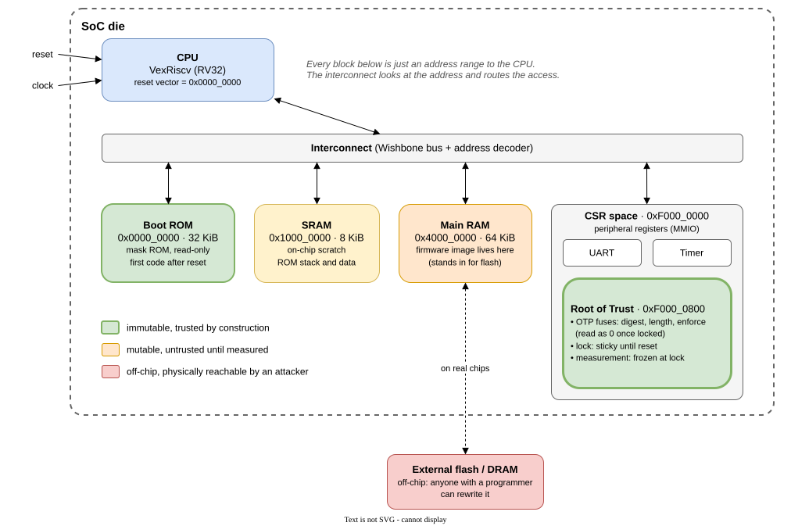
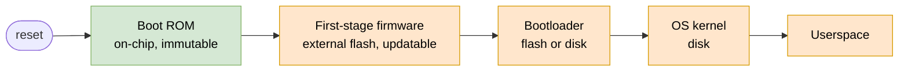
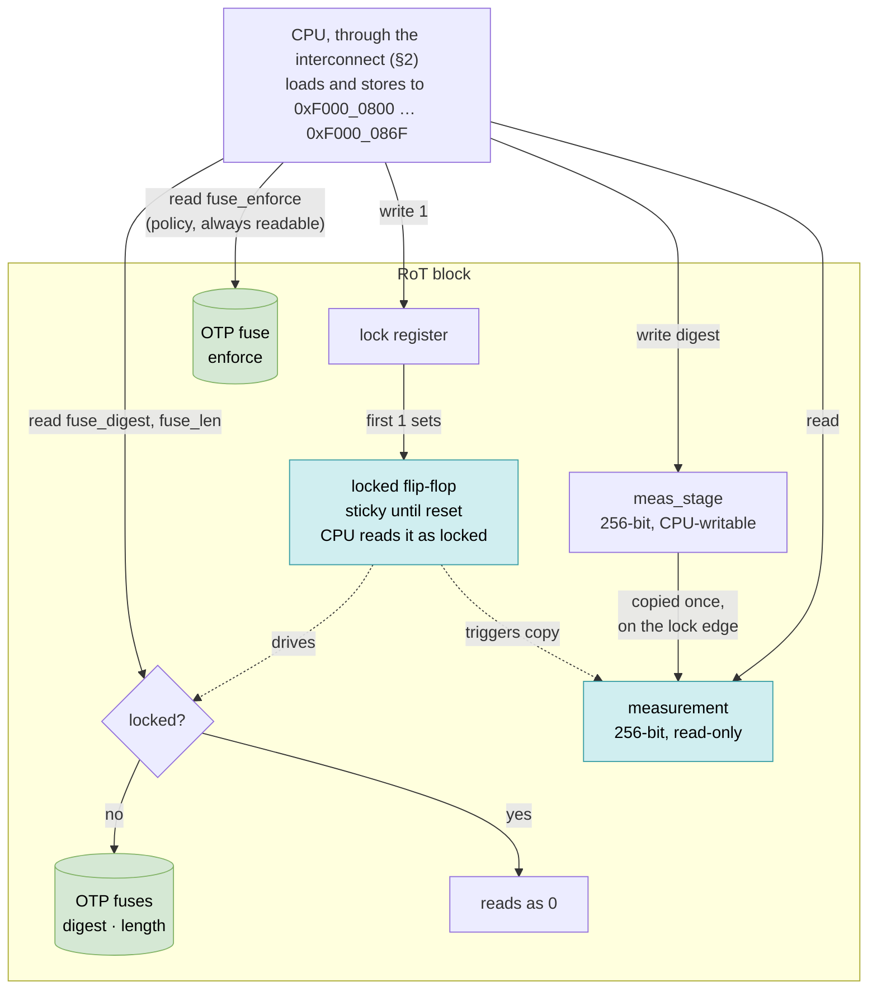
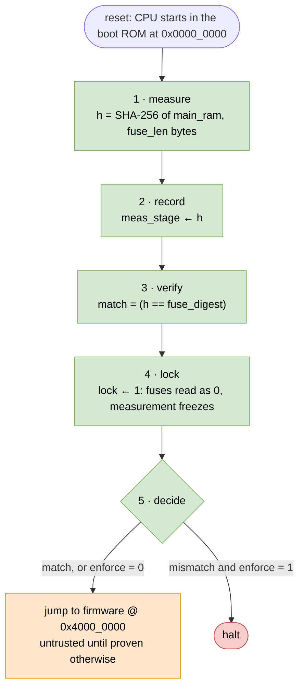
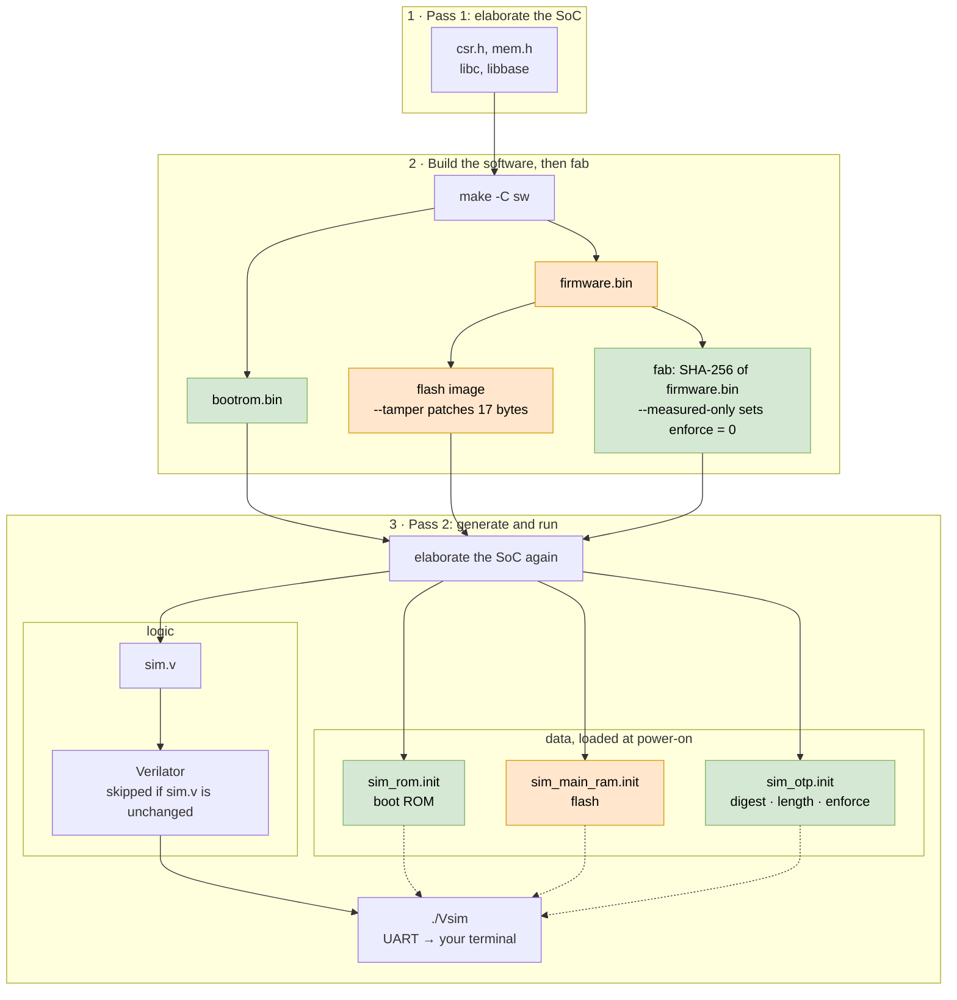
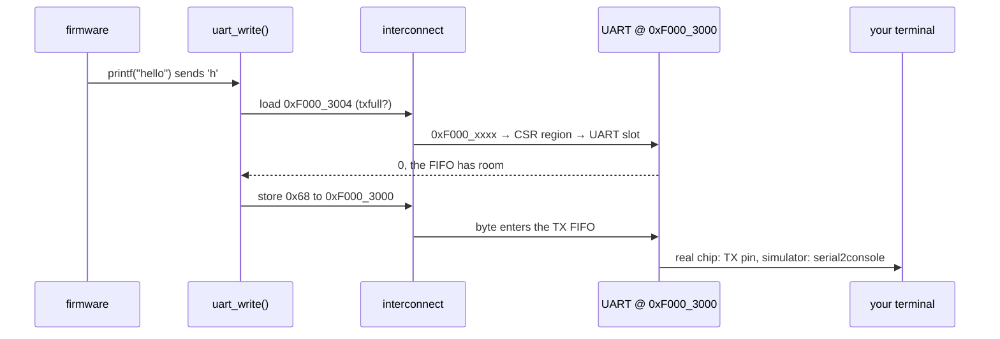

# Where Trust Begins: An SoC Mental Model, a Root of Trust, and a Chip You Can Boot on Your Laptop

*Audience: you write or debug system software, such as kernels, bootloaders, firmware, hypervisors, or device drivers. You know what MMIO, a reset vector, and "secure boot" mean as words. You have not seen how they map onto physical blocks inside a chip. We'll build that map, then boot a tiny SoC with a hardware Root of Trust in a cycle-accurate simulator and attack it.*

---

## 1. The premise

All the software you write runs on a **System-on-Chip (SoC)**. Your phone, your laptop's chipset, a Baseboard Management Controller (BMC), a smart NIC, a GPU, are all SoCs. When things "just works" at boot, a long chain of hardware and firmware decisions made it work. When it doesn't, the debugging vocabulary is all SoC vocabulary:

- *"The CPU comes out of reset at 0x0."* What lives at 0x0?
- *"Write 1 to the LOCK register."* Who is actually listening at that address?
- *"The fuses are blown at provisioning."* What's a fuse, and why can't firmware just rewrite it?
- *"Secure boot failed."* Who checked what, against what, and why was that checker trusted?

The goal of this post is a mental model you can carry into any of those conversations. We'll keep the theory short and concrete.

---

## 2. An SoC in one picture

A system traditionally consisted of multiple chips on a board, such as a CPU, memory controller, UART, and boot ROM. A **System-on-Chip (SoC)** integrates many of these components onto a single die, connected through an on-chip interconnect, which may be a bus or a network-on-chip (NoC). Main memory, such as DRAM, often remains external to the SoC.



*Lab SoC . Green blocks are immutable, orange ones are mutable and untrusted until measured, and red is off-chip.*

Key points to note in this SoC:

**1. Everything is an address.** The interconnect is, at its core, an address decoder. The CPU issues "read 4 bytes at 0xF0000800". The decoder looks at the high bits and routes the request to one target, then routes the reply back. ROM, RAM and peripheral registers all share this one address space. That's the **memory map**, and it's the first thing to learn about any SoC. Here's the one from our lab chip, as generated by LiteX into `mem.h`:

| Region     | Base         | Size   | What it is                                       |
|------------|--------------|--------|--------------------------------------------------|
| `rom`      | `0x00000000` | 32 KiB | Boot ROM. CPU starts here. Read-only.            |
| `sram`     | `0x10000000` | 8 KiB  | On-chip scratch RAM. Stack for the ROM.          |
| `main_ram` | `0x40000000` | 64 KiB | Stands in for external flash/DRAM. Firmware here.|
| `csr`      | `0xF0000000` | 64 KiB | All peripheral registers.                        |

**2. Peripherals are registers.** A UART, a timer or a crypto block looks to software like a small window of addresses. Each address is a **register**. LiteX calls them CSRs, *Control and Status Registers*. Writing a register is a *command*: "send this byte", "lock now". Reading a register is a *query*: "is the FIFO full?", "are we locked?". A device driver is a program that reads and writes these addresses in the right order.

**3. Reset is a hardware event with a fixed answer.** When reset is released, the CPU fetches its first instruction from a **reset vector**, an address hard-wired into the core. It's not configurable by software, because no software has run yet. Whatever lives at that address *is* the start of the system.

**4. Some things on-chip, some things off-chip.** On-chip ROM and fuses are inside the package. Attacking them takes decapping and probing. External flash and DRAM sit on the board.

**5. Hardware enforces, software requests.** A register can be wired so that writing it does nothing in a certain state. No privilege level, no clever code sequence gets around a gate that simply isn't connected. This is the property we'll lean on.

---

## 3. The boot chain and the chain of trust

Here's a typical boot (simplified):



Each stage loads the next and jumps to it. The question that matters for security: **how does stage N know that stage N+1 is the code you intended, and not code an attacker put in flash?**

The answer is a **chain of trust**. Each stage checks the next before handing over control. But a chain has to hang from something. The first link can't be checked by anything earlier, because there is nothing earlier. That first link is the **Root of Trust (RoT)**:

> **Root of Trust**: a component whose correct behaviour must be *assumed*, because nothing in the system can check it. Everything else's trustworthiness is derived from it.

Because it can't be checked, a RoT has to earn trust by construction:

| Property         | Why                                                        | How silicon gets it                                  |
|------------------|------------------------------------------------------------|------------------------------------------------------|
| **Immutable**    | If it can be modified, it can be modified by an attacker.  | Mask ROM: code fixed in the metal layers at fab.     |
| **Minimal**      | reduced blast radius.                   | ROMs are typically a few KiB to a few tens of KiB.   |
| **Holds a reference** | It must know what "good" looks like.                  | One-time-programmable **fuses** (OTP), burned at manufacturing. |
| **Can protect itself** | less-trusted code must not reach the secrets.  | **Lock** bits: write-once registers that close a door until next reset. |
| **Can report**   | Others (a remote server) need evidence of what booted.     | **Measurement** registers that later code can read but not forge. |

The RoT does one or both of two jobs:

- **Secure boot (verify):** compare the next stage against a reference and **refuse to run** it if it doesn't match.
- **Measured boot (record):** compute a fingerprint (hash) of the next stage and **record it** where it can't be altered later, then boot whatever is there. A remote verifier decides afterwards whether it trusts what was recorded. This is **attestation**.

You've probably met these already: UEFI Secure Boot verifies; the TPM PCRs and the event log in `/sys/kernel/security/tpm0/binary_bios_measurements` measure. Confidential-computing attestation (SEV-SNP, TDX) is measured boot with a signed report on top. They all start in some chip's ROM.

> ### 📦 Sidebar: Real Roots of Trust
>
> - **Intel Boot Guard**: the hash of the OEM's public key is burned into chipset fuses. An Intel-signed module checks the first firmware block against it before the main CPU runs any of it.
> - **AMD Platform Security Processor (PSP / ASP)**: a separate Arm core inside the CPU package. It boots first from its own ROM and verifies firmware before the x86 cores leave reset.
> - **Apple Boot ROM / Secure Enclave**: an immutable ROM verifies iBoot; a separate secure core holds keys.
> - **OpenTitan, Caliptra**: open-source silicon RoT designs. OpenTitan is a full RoT chip/IP with its own core, ROM, OTP and crypto engines. Caliptra is an RoT block meant to sit inside larger datacenter SoCs, focused on measurement and attestation.
>
> They differ in where the RoT logic runs: a dedicated core, or the main CPU running ROM code. The *pattern* is identical: **immutable code + fused reference + lockable hardware + measurement storage.** That pattern is what we'll build.

---

## 4. Our example lab SoC

The lab chip is a [LiteX](https://github.com/enjoy-digital/litex) SoC. LiteX is a Python framework for describing SoCs. It generates Verilog, which you can put on an FPGA or, as here, simulate cycle-accurately with Verilator. Ours include the following components:

- a **VexRiscv** 32-bit RISC-V CPU, reset vector = `0x0` (the ROM)
- 32 KiB **boot ROM** containing our boot code (`sw/bootrom.c`)
- 8 KiB **SRAM** for the ROM's stack and variables
- 64 KiB **main RAM** pre-loaded with the firmware image. In this toy it *plays the role of external flash*: untrusted, attacker-writable storage.
- a UART (wired to your terminal) and a timer
- and the new block: **`rot`, a Root of Trust peripheral**.

The diagram shows the RoT block from the CPU's side. Each column covers one thing the CPU can do: read the fuses, set the lock, or write and read the measurement. Follow the dotted lines to see how one flip-flop closes the fuse gate and freezes the measurement in the same clock cycle.



Green marks the OTP fuses, which the factory programs once. Teal marks the state the hardware guards after the lock: the flip-flop and the measurement. No arrow in the diagram clears `locked`. Only a reset does that, so code running after the ROM can't reopen the fuses or rewrite the measurement.

The table lists the same registers the way a datasheet would. Offsets count from the RoT's base address, `0xF000_0800`, and the 256-bit registers span eight 32-bit words. RO means the CPU can only read a register. The hardware can still change it, as `locked` and `measurement` do.

| Offset | Register       | Width | CPU view | Meaning                                                                     |
|--------|----------------|-------|----------|-----------------------------------------------------------------------------|
| `0x00` | `fuse_digest`  | 256   | RO       | SHA-256 of the firmware this chip was provisioned for. Reads 0 once locked. |
| `0x20` | `fuse_len`     | 32    | RO       | Length of that firmware in bytes. Reads 0 once locked.                      |
| `0x24` | `fuse_enforce` | 1     | RO       | Policy fuse: 1 = secure boot (halt on mismatch), 0 = measured boot only.    |
| `0x28` | `meas_stage`   | 256   | RW       | Where the ROM writes the digest it computed.                                |
| `0x48` | `measurement`  | 256   | RO       | Snapshot of `meas_stage` taken at lock time. Frozen until reset.            |
| `0x68` | `lock`         | 1     | RW       | Writing 1 sets `locked`. Writing 0 later does nothing to `locked`.          |
| `0x6C` | `locked`       | 1     | RO       | The flip-flop itself: reads 1 from the first lock write until reset.        |

After reset, the CPU runs five steps from the boot ROM. The green steps run on every boot, whatever sits in flash. Only step 5 branches.



Step 4 comes before step 5, so the ROM locks the RoT on both exits. The firmware that runs next, official or tampered, starts with the fuses hidden and the measurement frozen. Orange marks code the ROM hasn't vouched for. Red marks the halt.

The two exits match the two jobs from §3. Halting on a mismatch is **secure boot**. Booting anyway when the `enforce` fuse is 0 is **measured boot**: the frozen measurement tells a remote verifier what ran.

---

## 5. Hands-on: build and boot the SoC

### 5a. Setup

The lab lives next to this post in [`soc-rot-lab/`](soc-rot-lab/):

```
soc-rot-lab/
├── Containerfile     toolchain: LiteX 2026.08, Verilator, RISC-V GCC
├── rot_soc.py        the SoC + RoT block (Python/Migen) and the build/run flow
└── sw/
    ├── Makefile      builds both binaries against LiteX's generated headers
    ├── bootrom.c     immutable boot code (goes into ROM)
    ├── sha256.c      SHA-256, ~60 lines, in ROM
    └── firmware.c    the "updatable" firmware (goes into flash)
```

With Podman (or Docker), build the image once, then define a short `lab` wrapper so the rest of the post reads like native commands:

```bash
cd soc-rot-lab
podman build -t soc-rot-lab .
alias lab='podman run --rm -it -v "$PWD":/lab:Z -w /lab soc-rot-lab'
```

From here on, `lab ./rot_soc.py --tamper` runs `./rot_soc.py --tamper` inside the container. The container is throwaway, but the build output goes to `soc-rot-lab/build/` on your host, so it survives between runs. (Drop `:Z` if your host doesn't use SELinux.) If you installed the tools natively, leave out the `lab` prefix.

Natively, you need Python 3, Verilator 5, `libevent`/`json-c`/`zlib` headers, `meson`/`ninja`, and a bare-metal RISC-V GCC (`riscv64-unknown-elf-` or `riscv-none-elf-`). Then run `litex_setup.py --init --install --tag=2026.08` from a LiteX checkout. I developed the lab natively with LiteX 2026.08, Verilator 5.052 and xPack `riscv-none-elf-gcc` 14.2. I didn't build the Containerfile in that environment, so treat it as a starting point.

The first run takes a few minutes: LiteX compiles its C libraries, then Verilator compiles the whole SoC into a C++ simulator. Switching between the scenarios below doesn't change the hardware design, only memory contents, so later runs skip the Verilator step and start in seconds. `--trace` and edits to the Python hardware description cause one more full compile.

### 5b. What `rot_soc.py` does

The build has a chicken-and-egg problem, and real silicon has the same one. The software needs the hardware's memory map and register addresses. The ROM image is part of the hardware. So `rot_soc.py` works in three stages:



The `logic` box holds the design that a fab would turn into silicon. The `data` box holds what the factory and the field put into that silicon: the ROM image, the flash contents and the fuse values. The colors match the other diagrams: green for the immutable ROM and fuses, orange for the firmware and the flash that holds it.

Both run flags change only data files: `--tamper` edits the flash image and `--measured-only` edits one fuse word. All three scenarios below share one `sim.v` as a result. LiteX re-runs Verilator on every build, so `rot_soc.py` hashes `sim.v` and skips that step when the hash matches the last build.

### 5c. Warm-up: `printf` is a register write

Before the RoT, let's look at one of the familiar peripherals - **UART**. Every `[rom]` and `[fw]` line you'll see comes out of the **UART**. Following one character from `printf` to the hardware shows the same mechanism the RoT relies on.

After the first run, list the peripherals LiteX placed in CSR space:

```bash
grep "define CSR_.*_BASE " build/software/include/generated/csr.h
```

```c
#define CSR_CTRL_BASE       (CSR_BASE + 0x0L)     /* reset control, scratch register */
#define CSR_ROT_BASE        (CSR_BASE + 0x800L)   /* our Root of Trust               */
#define CSR_SIM_FINISH_BASE (CSR_BASE + 0x1000L)  /* simulator helpers: stop the     */
#define CSR_SIM_MARKER_BASE (CSR_BASE + 0x1800L)  /*   simulation, mark and trace    */
#define CSR_SIM_TRACE_BASE  (CSR_BASE + 0x2000L)  /*   waveforms                     */
#define CSR_TIMER0_BASE     (CSR_BASE + 0x2800L)  /* timer                           */
#define CSR_UART_BASE       (CSR_BASE + 0x3000L)  /* UART                            */
```

Each peripheral gets a 2 KiB slot, so this list is the memory map of the CSR region. (The timer is there because LiteX's support library needs one for `busy_wait()`. The lab itself never uses it.)

Now follow one character. `printf` ends up in LiteX's `uart_write()` (`libbase/uart.c`). With interrupts off, as they are here, that function is just:

```c
void uart_write(char c)
{
	while (uart_txfull_read());   /* load from 0xF000_3004: is the transmit FIFO full? */
	uart_rxtx_write(c);           /* store c to 0xF000_3000: send this byte            */
}
```

That's the whole driver. Read a **status** register until the hardware says it has room, then write a **data** register:



You can bypass `printf` completely. Add this line right after `uart_init();` in `sw/firmware.c` and rerun:

```c
uart_rxtx_write('!'); uart_rxtx_write('\n');
```

A `!` appears right after the ROM hands off. The firmware changed, so the fab step fuses the new digest and the image still boots. Remove the line afterwards to get back the digests shown in the runs below.

Keep the two verbs in mind: **a write is a command, a read is a query.** The RoT registers work the same way. `rot_lock_write(1)` is a command, and reading `fuse_digest` is a query. The difference is that the RoT's hardware sometimes refuses to answer.

### 5d. The RoT block

Here is the entire RoT block from `rot_soc.py`:

```python
class RootOfTrust(LiteXModule):
    def __init__(self, fuse_words):
        self.fuse_digest  = CSRStatus(256, ...)
        self.fuse_len     = CSRStatus(32,  ...)
        self.fuse_enforce = CSRStatus(1,   ...)
        self.meas_stage   = CSRStorage(256)
        self.measurement  = CSRStatus(256)
        self.lock         = CSRStorage(1)
        self.locked       = CSRStatus(1)

        otp   = Memory(32, len(fuse_words), init=fuse_words, name="otp")
        ports = [otp.get_port(async_read=True) for _ in fuse_words]
        self.specials += otp, *ports
        self.comb += [port.adr.eq(i) for i, port in enumerate(ports)]
        fuse = [port.dat_r for port in ports]

        locked = Signal()
        self.sync += If(self.lock.re & self.lock.storage[0] & ~locked,
            locked.eq(1),
            self.measurement.status.eq(self.meas_stage.storage),
        )
        self.comb += [
            self.locked.status.eq(locked),
            self.fuse_digest.status.eq(Mux(locked, 0, Cat(*reversed(fuse[:8])))),  # word 0 = MSW
            self.fuse_len.status.eq(Mux(locked, 0, fuse[8])),
            self.fuse_enforce.status.eq(fuse[9][0]),
        ]
```

Reading guide, if you've never seen an HDL:

- **`CSRStatus`** is a register the *hardware* drives and the CPU can only read. **`CSRStorage`** is a register the CPU writes and the hardware reads. LiteX assigns each one an address and generates C accessors for it.
- **`Signal()`** is a wire or a bit of state. `locked` is one bit.
- **`Memory`** is an array of words. `otp` is our fuse array: ten 32-bit words, each wired to its own read port so all of them can be read at once. `Cat(...)` concatenates the eight digest words into one 256-bit value.
- **`self.comb`** describes *combinational logic*: wires and gates, continuously evaluated, like a pure function of its inputs. `Mux(locked, 0, digest)` is a multiplexer: while `locked` is 1, the register's read path is physically connected to zero.
- **`self.sync`** describes *flip-flops*: state that updates only on a clock edge. The `If(...)` says: "on the clock edge where the CPU writes 1 to `lock` and we're not already locked, set `locked` and snapshot the measurement".
- **`.re`** pulses high for one clock cycle when the CPU writes that CSR. (In LiteX it is an alias for the write strobe; the name is historical.)

Notice what's *missing*: there's no statement that ever sets `locked` back to 0. The only way to clear that flip-flop is the global reset. That isn't a software policy. There's simply no wire that does it. Same for `measurement`: it's only assigned inside that one-shot `If`.

The fuse values themselves are in `build/gateware/sim_otp.init`, one hex word per line. This is the "fuse map" the factory programmed:

```
b7912a60   ┐
745537d7   │
e4201496   │
b9fd33c1   │ fuse_digest: SHA-256 of the official firmware
0ceb13fb   │
8c168449   │
839149d4   │
e966c79f   ┘
00001090     fuse_len: 4240 bytes
00000001     fuse_enforce: secure boot on
```

On real silicon, OTP fuses are programmed after fabrication, per device, and can't be un-programmed. In the simulation the "programming" happens when the simulator loads this file at power-on. Note that the design gives the CPU no write port to `otp`. Software can't change a fuse, because no wire for it exists.

### 5e. The generated register map

Pass 1 produces `build/software/include/generated/csr.h`. This is how the C code finds the hardware:

```c
#define CSR_ROT_FUSE_DIGEST_ADDR  (CSR_BASE + 0x800L)   /* 8 x 32-bit words */
#define CSR_ROT_FUSE_LEN_ADDR     (CSR_BASE + 0x820L)
#define CSR_ROT_FUSE_ENFORCE_ADDR (CSR_BASE + 0x824L)
#define CSR_ROT_MEAS_STAGE_ADDR   (CSR_BASE + 0x828L)   /* 8 words */
#define CSR_ROT_MEASUREMENT_ADDR  (CSR_BASE + 0x848L)   /* 8 words */
#define CSR_ROT_LOCK_ADDR         (CSR_BASE + 0x868L)
#define CSR_ROT_LOCKED_ADDR       (CSR_BASE + 0x86cL)

static inline void rot_lock_write(uint32_t v) {
	csr_write_simple(v, (CSR_BASE + 0x868L));
}
```

`csr_write_simple` is just a volatile store to that address. Your Linux drivers' `writel()` does the same thing, plus barriers.

A 256-bit register spans eight 32-bit words. LiteX defaults to *big ordering*: the most significant word is at the lowest address. That happens to match how SHA-256 lays out its eight state words, so the ROM can compare digests word-for-word with no byte-swapping.

### 5f. The boot ROM

The core of `sw/bootrom.c`:

```c
uint32_t len = csr_read_simple(CSR_ROT_FUSE_LEN_ADDR);
int enforce  = rot_fuse_enforce_read();

sha256((const uint8_t *)MAIN_RAM_BASE, len, meas);           // 1. measure

for (int i = 0; i < 8; i++) {
	golden[i] = csr_read_simple(CSR_ROT_FUSE_DIGEST_ADDR + 4 * i);
	csr_write_simple(meas[i], CSR_ROT_MEAS_STAGE_ADDR + 4 * i); // 2. record
	match &= golden[i] == meas[i];                          // 3. verify
}

rot_lock_write(1);                                          // 4. lock

if (!match && enforce) {                                    // 5. decide
	printf("[rom] SECURE BOOT FAILURE ...");
	for (;;);
}
flush_cpu_icache();
((void (*)(void))MAIN_RAM_BASE)();                          // hand off
```

`flush_cpu_icache()` before jumping is essential. The CPU has an instruction cache, so when you jump into memory you just wrote to or loaded from, you must ensure the instruction cache doesn't serve stale bytes. Both bootloaders and JITs share this concern.

### 5g. Run 1: the happy path

```bash
lab ./rot_soc.py
```

```
...

[fab] fusing firmware digest b7912a60745537d7e4201496b9fd33c10ceb13fb8c168449839149d4e966c79f (4240 bytes)

...

[rom] reset vector reached, boot ROM running
[rom] measured firmware : b7912a60745537d7e4201496b9fd33c10ceb13fb8c168449839149d4e966c79f
[rom] fused golden      : b7912a60745537d7e4201496b9fd33c10ceb13fb8c168449839149d4e966c79f
[rom] RoT locked: fuses hidden, measurement frozen
[rom] digest matches fuse, jumping to firmware @ 0x40000000

[fw] hello from the official firmware
[fw] RoT locked = 1
[fw] fuse digest read   : 0000000000000000000000000000000000000000000000000000000000000000
[fw] RoT locked = 1 after trying to clear it
[fw] attested measurement: b7912a60745537d7e4201496b9fd33c10ceb13fb8c168449839149d4e966c79f
- /lab/build/gateware/sim.v:1787: Verilog $finish
```
(Your digest will differ: it depends on your compiler version.) Walk through it:

- The `[fab]` line is Python's `hashlib`. The `[rom]` measured line is our 60-line C SHA-256 running on a simulated RISC-V core. They agree, so the ROM's crypto is correct.
- The firmware runs and then tries two attacks (`sw/firmware.c`):
  1. **Read the fuses.** It gets zeros. The mux took the data path away.
  2. **Unlock and forge.** It writes 0 to `lock`, scribbles `0xdeadbeef` over `meas_stage`, and writes 1 to `lock` again, hoping for a fresh snapshot. `locked` stays 1, and the `measurement` it then reads is still the real digest. The one-shot `If` already fired.

### 5h. Run 2: an attacker reflashes the firmware

```bash
lab ./rot_soc.py --tamper
```

`--tamper` models someone with physical access rewriting the flash chip. The fuses still hold the official digest, but the bytes in "flash" now say something else: the script patches the string `official firmware` into `EVIL  firmware!!!`.

```
[fab] fusing firmware digest b7912a60745537d7e4201496b9fd33c10ceb13fb8c168449839149d4e966c79f (4240 bytes)
[attacker] flash now hashes to  340dc0308ab1d1e471e8ba61e4df7ba3e0c69727c0568d7bb40c35c02503a218

[rom] reset vector reached, boot ROM running
[rom] measured firmware : 340dc0308ab1d1e471e8ba61e4df7ba3e0c69727c0568d7bb40c35c02503a218
[rom] fused golden      : b7912a60745537d7e4201496b9fd33c10ceb13fb8c168449839149d4e966c79f
[rom] RoT locked: fuses hidden, measurement frozen
[rom] SECURE BOOT FAILURE: firmware is not the one this chip was provisioned for. Halting.
- /lab/build/gateware/sim.v:1787: Verilog $finish
```

17 changed bytes out of 4240 give a completely different digest. The evil code never runs a single instruction. That's **secure boot** failure.

### 5i. Run 3: measured boot and attestation

```bash
lab ./rot_soc.py --tamper --measured-only
```

Now the `enforce` fuse is 0. This chip's policy is "boot anything, but record what you booted". Plenty of real systems work this way: PCs with a TPM but without enforced secure boot, and servers that rely on remote attestation.

```
[rom] measured firmware : 340dc0308ab1d1e471e8ba61e4df7ba3e0c69727c0568d7bb40c35c02503a218
[rom] fused golden      : b7912a60745537d7e4201496b9fd33c10ceb13fb8c168449839149d4e966c79f
[rom] RoT locked: fuses hidden, measurement frozen
[rom] MISMATCH (measured-boot mode, booting anyway), jumping to firmware @ 0x40000000

[fw] hello from the EVIL  firmware!!!
[fw] RoT locked = 1
[fw] fuse digest read   : 0000000000000000000000000000000000000000000000000000000000000000
[fw] RoT locked = 1 after trying to clear it
[fw] attested measurement: 340dc0308ab1d1e471e8ba61e4df7ba3e0c69727c0568d7bb40c35c02503a218
```

The evil firmware is running and fully in control of the CPU. It still **cannot lie about itself**. The `measurement` register holds `340dc0…`, and the evil code has no way to make it read `b7912a…`. When it reports to a remote verifier, for example to receive a disk key or join a cluster, the verifier compares against the known-good value and refuses.

In a real system, the measurement would be *signed* by a device-unique key that only the RoT can use. Otherwise the evil firmware could just send the verifier a made-up number instead of reading the register. That's the next layer up (see §6), but the hardware primitive is exactly this: a register that only the thing that ran *before* you could write.

### 5j. Optional: watch the lock in a waveform

The console shows what the firmware saw. A waveform shows what the hardware did, one clock cycle at a time.

```bash
lab ./rot_soc.py --trace
```

A trace of the whole boot would record every signal for half a second of simulated time. To keep the file small, the ROM switches recording on through LiteX's `sim_trace` register right before it locks, and the firmware switches it off after its second attack. The console marks both moments with `<DUMP ON>` and `<DUMP OFF>`. The window covers about 40,000 clock cycles, around 110 MB of VCD.

When the simulation ends, `rot_soc.py` reads the VCD and prints every change on six RoT signals. Cycles count from `<DUMP ON>`:

```
[trace] cycle  signal              value
[trace]     0  lock_storage        0
[trace]     0  locked              0
[trace]     0  fuse_digest_status  b7912a60745537d7e4201496b9fd33c10ceb13fb8c168449839149d4e966c79f
[trace]     0  lock_wr_stb         0
[trace]     0  meas_stage_storage  b7912a60745537d7e4201496b9fd33c10ceb13fb8c168449839149d4e966c79f
[trace]     0  measurement_status  0
[trace]    20  lock_storage        1
[trace]    20  lock_wr_stb         1
[trace]    21  locked              1
[trace]    21  fuse_digest_status  0
[trace]    21  lock_wr_stb         0
[trace]    21  measurement_status  b7912a60745537d7e4201496b9fd33c10ceb13fb8c168449839149d4e966c79f
[trace] 39682  lock_storage        0
[trace] 39682  lock_wr_stb         1
[trace] 39683  lock_wr_stb         0
[trace] 39688  meas_stage_storage  deadbeef745537d7e4201496b9fd33c10ceb13fb8c168449839149d4e966c79f
[trace] 39690  meas_stage_storage  deadbeefdeadbeefe4201496b9fd33c10ceb13fb8c168449839149d4e966c79f
  ...                              (one more deadbeef word every 2 cycles)
[trace] 39702  meas_stage_storage  deadbeefdeadbeefdeadbeefdeadbeefdeadbeefdeadbeefdeadbeefdeadbeef
[trace] 39730  lock_storage        1
[trace] 39730  lock_wr_stb         1
[trace] 39731  lock_wr_stb         0
```

| Signal               | What it is                                   |
|----------------------|----------------------------------------------|
| `lock_wr_stb`        | one-cycle pulse on every CPU write to `lock` |
| `lock_storage`       | the value of the last write to `lock`        |
| `locked`             | the sticky flip-flop                         |
| `fuse_digest_status` | what a read of `fuse_digest` returns         |
| `meas_stage_storage` | the CPU-writable staging register            |
| `measurement_status` | the frozen measurement                       |

Read the table in two parts. The cycle numbers come from my run, and a different compiler shifts them a little.

**The lock, cycles 20 and 21.** At cycle 20 the ROM writes 1 to `lock`: `lock_wr_stb` pulses and `lock_storage` goes to 1. At cycle 21, on one clock edge, three signals change together:

- `locked` rises to 1.
- `fuse_digest_status` drops from `b7912a…` to 0.
- `measurement_status` takes the value of `meas_stage_storage`.

That edge is the `self.sync += If(...)` block from §5d.

**The attacks, cycles 39682 to 39731.** The firmware runs its second attack from §5g:

- It writes 0 to `lock`. `lock_storage` follows it to 0, and `locked` doesn't appear in the table again.
- It writes `0xdeadbeef` eight times. `meas_stage_storage` fills up one 32-bit word per write, most significant word first. `measurement_status` doesn't change.
- It writes 1 to `lock` again. `lock_wr_stb` pulses and nothing else changes, because the `If` fires only while `locked` is 0.

Compare `lock_storage` with `locked`. `lock_storage` is an ordinary register and follows every write. `locked` changes once, and only a reset can bring it back to 0.

**Seeing it in GTKWave.** The run also writes a GTKWave save file. Open both files on your host (GTKWave is a GUI app):

```bash
gtkwave build/gateware/sim.vcd build/gateware/rot.gtkw
```

The view opens with the clock and the six signals already added (as `make_soc_rot_*`: Migen prefixes each name with the function and submodule that built it). The 256-bit values show in hex, and the view is zoomed in on the lock. The primary marker sits on the lock edge, and marker A sits on the first attack. Two things about GTKWave help here:

- The value column shows each signal's value at the **primary marker**, not at the scrollbar position. Click in the wave area to move the marker, and the values update.
- A single-cycle pulse is far narrower than a pixel when the whole trace is on screen, so everything looks flat when you zoom out. To reach the attacks, scroll right to marker A, about 40,000 cycles in, and zoom in there with the toolbar's zoom buttons.

---

## 6. What this lab SoC leaves out (on purpose)

The lab models the *shape* of an RoT. Production designs add layers you should know exist:

- **Key hash in fuses, not image hash.** We fused the hash of one firmware image, so a firmware update would need new fuses. Real chips fuse the hash of a *public key*, and the ROM verifies a *signature* over the image. The vendor can then ship updates signed with the private key.
- **Anti-rollback.** A validly signed but *old, vulnerable* firmware is still validly signed. Real RoTs keep a minimum security version in OTP fuses (a monotonic counter that can only go up) and refuse anything older.
- **Time-of-check vs time-of-use.** Our ROM hashes the image and executes it in place. If the image lives in external flash that's read twice, an attacker can swap the bytes between hash and execution. Real ROMs first copy the image into on-chip SRAM, then verify the copy, then run the copy.
- **Other bus masters.** The CPU isn't the only thing that can write memory. A DMA engine or a PCIe device could rewrite firmware *after* verification. Bus firewalls, IOMMUs and memory protection (e.g. RISC-V PMP) close that gap.
- **Fault injection.** A voltage glitch at the right nanosecond can skip the `if (!match && enforce)` branch. Hardened ROMs compare twice, use multi-bit magic values instead of booleans, and add random delays.
- **Debug ports.** JTAG can halt the CPU and poke registers directly. Production RoTs fuse debug off, or gate it behind authenticated unlock.
- **Identity and chained measurements.** A measurement register with a single slot only covers one hop. TPM PCRs *extend*: `PCR = H(PCR || next_digest)`, so a whole chain folds into one value no one can rewind. **DICE** (TCG's Device Identifier Composition Engine) goes further: it derives the next stage's secret key from a fused device secret *and* the measurement. Booting different code yields a different key, so nothing has to be "trusted to report honestly".
- **A separate core.** Here the main CPU runs the ROM. In AMD's PSP, Apple's SEP, OpenTitan and Caliptra, the RoT has its own processor, memory and crypto engines. The main CPU only gets to talk to it through a mailbox.

None of these change the mental model though.

---

## 7. Using the mental model

Next time you're in a boot log, a device tree, or a vendor datasheet, try placing each thing on the picture from §2:

- **"Reset vector", "BL1", "mask ROM", "boot ROM"**: the top-left box. Immutable; whatever it trusts is your root.
- **"eFuse", "OTP", "FPF", "fuse bank"**: the reference values that box compares against. They're on-chip and one-way.
- **"Lock bit", "write-once", "sticky until reset"**: our `locked` flip-flop. Look for these whenever early firmware "hands off" to later firmware.
- **"PCR", "measurement", "event log", "attestation report"**: our `measurement` register, plus signatures and a chain.
- **A driver writing a magic value to an offset**: a CSR on the interconnect. Find the block that owns that address in the memory map and the behaviour usually becomes obvious.

And the single most useful question when reading any security design: **"After this step, which component could still change this value, and through which wire?"** If the answer is "nothing, there is no wire", you've found the hardware root.

---

## 8. Next Steps

You can try these small experiments. Each is a small edit to `rot_soc.py` or `sw/*.c`, followed by a rerun.

1. **Forget to lock.** Comment out `rot_lock_write(1)` in `bootrom.c` and run `--tamper --measured-only`. What can the evil firmware read now? Can it make its attested measurement look like the golden one?
2. **Write to the ROM.** Add `*(volatile uint32_t *)ROM_BASE = 0;` to `firmware.c`. The firmware stops making progress. Work out why.
3. **Anti-rollback.** Add a `fuse_min_version` CSR and a version word at the start of the firmware image. Make the ROM refuse images older than the fuse.
4. **PCR-style extend.** Give the firmware a way to extend a second measurement (`m = SHA-256(m || x)`) without being able to *set* it. Where must the hashing happen for that to be safe, in software or in hardware?
5. **Lock earlier.** Move the lock so that the fuses become unreadable as soon as the ROM has copied them into SRAM. What does that buy you, and what new risk does SRAM introduce?