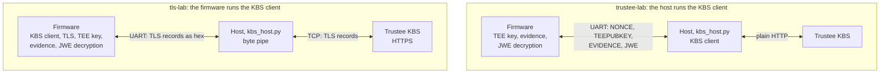

# Taking the Host Out of the Protocol: A Bare-Metal TEE Talks TLS to Trustee

*Audience: you've read [Teaching Trustee a New TEE](trustee-attestation-blog.md). In that post's lab, the untrusted host ran the KBS client: it spoke plain HTTP to Trustee and passed messages to the chip over the UART. This short post moves the KBS client into the chip's firmware. The firmware speaks HTTPS to Trustee, over TLS that ends inside the chip, and the host shrinks to a byte pipe. No VM and no Linux are involved: it's bare-metal confidential computing.*

---

## 1. The gap: who sent the secret?

The two labs give the KBS client to different parties.

In the third post's lab, [`trustee-lab/`](trustee-lab/), the host is the mediator, and it runs the KBS client. `kbs_host.py` sends the `/auth`, `/attest` and `/resource` requests to Trustee over plain HTTP. It talks to the chip over the UART with a line protocol: it sends the KBS nonce, receives the TEE public key and the evidence, and sends back the JWE that holds the secret. The host reads every message. The firmware does only the steps that need a key: it creates the TEE key, signs the evidence, and decrypts the JWE.

In this post's lab, [`tls-lab/`](tls-lab/), the firmware runs the KBS client itself and speaks HTTPS to Trustee. The host still opens the TCP connection, but it carries only TLS records that it can't read or change.



The `trustee-lab` design held up against forged evidence, replays and key swaps, because the evidence binds the KBS nonce and the chip's TEE key, and the secret arrives encrypted to that key.

It doesn't hold up against one attack. The chip never checks *who* encrypted the secret, and anyone can encrypt to a public key. A hostile host can skip Trustee, play KBS itself, and hand the chip a key of its own choosing:

```bash
cd trustee-lab
lab ./trustee_soc.py --impersonate
```

```
[fw] hello from the official firmware
[host] pretending to be Trustee: no attestation, sending a key the attacker chose
[fw] decrypted the secret from Trustee: "attacker's disk key: all yours!!"
```

If the workload then encrypts a disk with that key, the attacker can read the disk later. Confidential computing protects against a hostile host, so this hole matters.

The real Attestation Agent avoids it because it talks to KBS over TLS from inside the TEE, and trusts the KBS certificate through configuration the TEE measures. In Confidential Containers, the KBS address and certificate travel in *init-data*, whose hash goes into the attestation evidence. The host carries TLS bytes it can neither read nor forge.

---

## 2. The fix: TLS that ends in the chip

The lab in [`tls-lab/`](tls-lab/) moves the whole client into the firmware. The host keeps one job, carrying bytes:

| Step | `trustee-lab` (third post) | `tls-lab` (this post) |
|---|---|---|
| TCP connection to Trustee | host | host |
| TLS | none (plain HTTP) | **firmware**, with the KBS key pinned |
| HTTP, cookies and JSON for `/auth`, `/attest`, `/resource` | host (`kbs_host.py`) | **firmware** |
| TEE key, REPORT_DATA, evidence | firmware | firmware |
| JWE decryption | firmware | firmware |

The firmware opens a "TCP connection" by printing `TCP OPEN`. From then on, every byte it sends or receives travels as hex lines over the UART, and `kbs_host.pipe()` forwards them to the KBS socket without looking at them.

**Pinning the KBS key.** `tls_soc.py` gives Trustee a TLS key pair once, then writes the public key into `sw/kbs_pinned_key.h` before it compiles the firmware. The pinned key ends up in the firmware image, so it's part of the measurement the ROM certifies. Firmware that trusts a different server measures differently, and Trustee won't release the tenant's secrets to it. This plays the role of CoCo's measured init-data.

**The TLS client.** BearSSL ships a TLS 1.2 client. The firmware configures it for one cipher suite and the algorithms that suite needs:

```c
br_ssl_engine_set_versions(&tls.eng, BR_TLS12, BR_TLS12);
br_ssl_engine_set_suites(&tls.eng, suites, 1);   /* ECDHE-ECDSA-AES128-GCM-SHA256 */
br_ssl_engine_set_ec(&tls.eng, &br_ec_p256_m31);
br_ssl_engine_set_ecdsa(&tls.eng, &br_ecdsa_i31_vrfy_asn1);
...
/* The server must prove it holds the private half of the pinned key: it signs the handshake with it. */
br_x509_knownkey_init_ec(&pinned, &kbs_key, BR_KEYTYPE_KEYX | BR_KEYTYPE_SIGN);
br_ssl_engine_set_x509(&tls.eng, &pinned.vtable);
```

`br_x509_knownkey` skips certificate-chain processing and hands the TLS engine the pinned key. During the handshake the server signs its ephemeral ECDH key, and the chip checks that signature against the pinned key. A server without the matching private key can't produce it. Trustee's KBS accepts TLS 1.2 with this suite in its default TLS profile.

Over that session, the firmware sends the same three requests as the third post's host did, then decrypts the JWE as before. It also reads the appraisal out of the EAR token itself. The `[fw]` lines below come from inside the TLS session.

---

## 3. Three things a 1 MHz TEE taught us

**Timeouts.** KBS's web server, actix-web, gives a client 3 seconds to finish the TLS handshake and 5 seconds between requests. The simulated chip needs about a minute for the handshake: it verifies the server's ECDSA signature and does an ECDH, each worth millions of cycles. The lab adds one patch, `kbs-slow-client.patch`, that raises those limits to ten minutes. It's marked lab-only. A real embedded TEE with crypto hardware finishes in milliseconds.

**Flow control.** The simulator's UART bridge buffers 2 KiB of input. KBS's attestation response is bigger than that, and the first version lost bytes in the middle of a TLS record. Now the firmware asks for each chunk with `TCP MORE`, and the host sends at most 256 bytes per request. Real drivers solve the same problem with descriptor rings and credits.

**Randomness.** TLS needs fresh random numbers, and the lab SoC has no random number generator. The firmware derives its TLS randomness from the secret Alias key mixed with 32 bytes from the host. The host can't predict the result, because it doesn't know the Alias key. It could make two sessions repeat their randomness by sending the same bytes twice, though. A real TEE uses its hardware RNG.

The firmware grows to 83 KB with the TLS stack, so the firmware partition grows to 128 KiB, and SRAM to 128 KiB for BearSSL's 33 KiB TLS buffer.

---

## 4. Hands-on

Setup matches the third post. `trustee/setup.sh` applies one extra patch, the timeout change:

```bash
cd tls-lab
podman build -t tls-lab .
alias lab='podman run --rm -it -v "$PWD":/lab:Z -w /lab tls-lab'
```

Each run takes one to one and a half minutes, mostly for the TLS handshake.

**Official firmware:**

```bash
lab ./tls_soc.py
```

```
[operator] Trustee's TLS key 6c72b0ce6c51fc5d... pinned into the firmware
[tenant] Trustee knows DeviceID fb18b4ef76c33fe3... and firmware 0b58aff044e4c22e..., holds the secret at default/key/tenant-42
[rom] firmware measurement : 0b58aff044e4c22e817befac254cc40512e5e6f7cd667ebd012ed2b1855e66d0
[fw] hello from the official firmware
[host] connected the chip to 127.0.0.1:8080, relaying bytes it can't read
[fw] TLS session with the pinned Trustee key; KBS nonce W1wu3YWHq/ZqOiSa...
[fw] Trustee accepted the evidence, appraisal: affirming
[fw] decrypted the secret from Trustee: "tenant-42 disk key: open sesame!"
```

The host's only line says it connected a socket. Everything after that happens inside TLS.

**Modified firmware:**

```bash
lab ./tls_soc.py --tamper
```

```
[fw] hello from the EVIL  firmware!!!
[host] connected the chip to 127.0.0.1:8080, relaying bytes it can't read
[fw] TLS session with the pinned Trustee key; KBS nonce f2xOlMYTT48qMSqN...
[fw] Trustee accepted the evidence, appraisal: warning
[fw] Trustee refused the secret: HTTP 401
```

The evil firmware reaches the real Trustee, and Trustee's policy refuses it, as in the third post. TLS leaves the attestation checks as they were and makes sure the chip talks to the real Trustee.

**A host that impersonates Trustee:**

```bash
lab ./tls_soc.py --impersonate
```

```
[host] hostile: the chip's connection goes to a fake KBS with its own certificate
[fw] hello from the official firmware
[host] connected the chip to 127.0.0.1:45745, relaying bytes it can't read
[fw] TLS failed, BearSSL error 27: the server's handshake signature doesn't match the pinned Trustee key
```

The same attack that worked in §1 now fails during the TLS handshake. The fake server holds a valid key pair and certificate, but not the pinned key. The chip aborts before it sends any evidence or receives any secret.

---

## 5. What's still missing

- **Isolation.** The host still runs the simulator and could read the chip's RAM, Alias key included. A real TEE stops that with the access checks and memory encryption from the second post. This lab shows the *client* side of confidential computing, not the memory protection.
- **TLS 1.3 and certificate chains.** BearSSL speaks TLS 1.2 only. Pinning one key also means that rotating the KBS key needs new firmware and a new reference value. A CA certificate in the measured configuration would allow rotation.
- **A hardware RNG**, as §3 explains.

With these changes, 83 KB of bare-metal firmware does the Attestation Agent's job from a confidential VM: it attests, authenticates Trustee, and receives secrets that no one on the path can read or replace.

---

*Built on [LiteX](https://github.com/enjoy-digital/litex) 2026.08, [Trustee](https://github.com/confidential-containers/trustee) v0.22.0, [Monocypher](https://monocypher.org) 4.0.2 and [BearSSL](https://bearssl.org) 0.6.*
