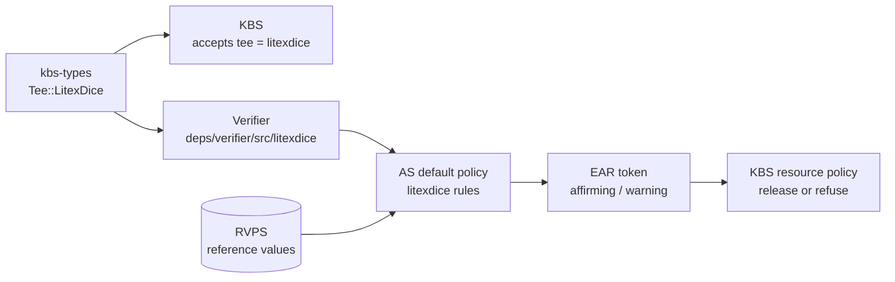
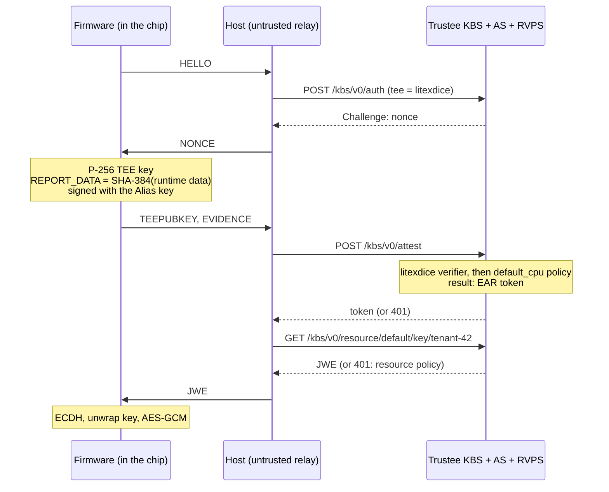

# Teaching Trustee a New TEE: The DICE Lab Chip Meets a Real Key Broker

*Audience: you have read [Proving What Runs](cc-attestation-blog.md), the second post in this series, where a simulated LiteX SoC with a DICE boot ROM attested to a Python verifier. This post replaces that verifier with [Trustee](https://github.com/confidential-containers/trustee), the attestation and key broker service of the Confidential Containers project. You'll add the lab chip to Trustee as a new TEE type, the same way support for SEV-SNP or TDX is built, and watch Trustee release a secret to the chip only when its evidence holds up.*

---

## 1. From a hand-written verifier to Trustee

The second post's `verifier.py` did four checks and released a secret. Production systems don't write that code per application. They run a shared service that understands each TEE's evidence format, compares claims against reference values, applies policy, and hands out keys. Trustee is that service in the Confidential Containers world.

The [Trustee chapter of the CC book](https://cc-book.github.io/cc-book/trustee/) covers its components and flows. This post needs three of them:

- **KBS** (Key Broker Service) talks to the TEE and releases secrets. In attestation terms it's the *relying party*.
- **AS** (Attestation Service) checks evidence with a per-TEE *verifier*, then appraises the result with a policy.
- **RVPS** (Reference Value Provider Service) stores the known-good values the policy compares against.

Each check from the second post has a home in Trustee:

| Check in `verifier.py` | Where it lives in Trustee |
|---|---|
| 1. the DeviceID key belongs to a genuine chip | AS policy rule, against a value in the RVPS |
| 2. the chip's ROM signed the Alias certificate | the TEE's verifier |
| 3. the certified measurement is the vendor's firmware | AS policy rule, against a reference value in the RVPS |
| 4. the report carries our nonce and the Alias key signed it | the TEE's verifier, plus KBS's nonce handling |
| release the secret, encrypted to the firmware's key | KBS resource policy, and a JWE encrypted to the TEE's public key |

The split follows a rule Trustee uses for every TEE. **The verifier establishes facts**: these bytes came from this key, and this session's nonce is in them. **The policy makes decisions**: whether that key is trusted and whether that measurement is acceptable. A verifier that rejects evidence is saying "this is forged". A policy that refuses a secret is saying "this is genuine, and I don't trust it".

---

## 2. What adding a TEE type touches

Trustee knows each TEE type by name, from `snp` and `tdx` to `cca` and `se`. Adding the lab chip, as `litexdice`, takes four pieces. The lab keeps them in [`trustee-lab/trustee/`](trustee-lab/trustee/) as one new source file and three small patches against Trustee **v0.22.0**:



### 2a. The type: one enum variant

Trustee's message types live in a separate crate, `kbs-types`. Its `Tee` enum names every TEE that KBS accepts in a `Request`. The patch adds one variant (`kbs-types.patch`):

```rust
    // LiteX DICE lab chip: a simulated SoC whose boot ROM implements DICE
    #[strum(serialize = "litexdice")]
    LitexDice,
```

Trustee's workspace then points at the patched crate with a `[patch.crates-io]` entry. Upstream, this step would be a pull request to `kbs-types` and a version bump.

### 2b. The verifier: facts from evidence

A verifier implements one trait method. It receives the TEE's evidence as JSON, the REPORT_DATA that KBS expects for this session, and an optional init-data hash. It returns claims. The `litexdice` verifier (`litexdice/mod.rs`, about 90 lines plus a test) makes three checks:

```rust
// 1. The chip's ROM issued the certificate: DeviceID signed Alias key + measurement.
verify(&device_id, &cert[..64], cert_sig).context("Alias certificate")?;

// 2. The certified firmware produced this evidence: the Alias key signed REPORT_DATA.
verify(alias_pub, &report_data, &signature).context("REPORT_DATA signature")?;

// 3. The evidence belongs to this session: REPORT_DATA hashes the KBS nonce and the
//    firmware's TEE public key, so a recording of an older session doesn't match.
if let ReportData::Value(expected) = expected_report_data {
    if *expected != report_data {
        bail!("REPORT_DATA does not match this session's nonce and TEE public key");
    }
}
```

Then it returns what it proved, as claims for the policy:

```rust
let claims = json!({
    "device_id": ev.device_id,
    "measurement": hex::encode(measurement),
    "alias_pub": hex::encode(alias_pub),
    "report_data": ev.report_data,
});
Ok(vec![(claims as TeeEvidenceParsedClaim, "cpu".to_string())])
```

The `"cpu"` TEE class tells the AS which default policy to run, `default_cpu`. A unit test in the same file builds a genuine DICE chain with `ed25519-compact` and checks four cases: genuine evidence passes, while evidence from another session, a forged certificate and a swapped Alias key all fail.

`trustee.patch` wires the verifier in. It adds a `litexdice-verifier` feature to the verifier and AS crates, includes it in `all-verifier`, and adds one arm to the dispatch in `deps/verifier/src/lib.rs`:

```rust
Tee::LitexDice => {
    cfg_if::cfg_if! {
        if #[cfg(feature = "litexdice-verifier")] {
            Ok(Box::<litexdice::LitexDice>::default() as Box<dyn Verifier + Send + Sync>)
        } else {
            bail!("feature `litexdice-verifier` is not enabled for `verifier` crate.")
        }
    }
}
```

### 2c. The policy: decisions from claims

The AS turns claims into an EAR token (Entity Attestation Result, an IETF draft). Its core is a *trust vector*: small integers for properties such as `executables`, `hardware` and `configuration`. Values from 2 to 31 mean affirming, 32 to 95 mean warning, and 96 and above mean contraindicated. The token's overall status follows the worst value.

Trustee's default CPU policy starts every claim at a non-affirming value (`executables 33`, `hardware 97`, `configuration 36`). Then each TEE type adds rules that raise them. The patch adds a `litexdice` section next to the ones for `sample`, `snp` and the others:

```rego
executables := 3 if {
	input.litexdice
	input.litexdice.measurement in query_reference_value("litexdice_firmware_measurement")
}

hardware := 2 if {
	input.litexdice
	input.litexdice.device_id in query_reference_value("litexdice_device_id")
}

configuration := 2 if {
	input.litexdice
}
```

`input.litexdice` holds the verifier's claims. The AS files them under the TEE type's name. `query_reference_value` reads from the RVPS. The `executables` rule is post 2's check 3, and the `hardware` rule is check 1.

The manufacturer's list of genuine DeviceIDs ends up in the RVPS too. That keeps the lab simple. A production verifier for real silicon embeds or fetches the vendor's root certificate instead: Trustee's SNP verifier, for example, checks AMD's certificate chain itself.

### 2d. The reference values and the secret

The tenant loads both reference values and the secret through KBS's admin API before the chip boots. `kbs_host.provision()` does it with three plain HTTP calls:

- `POST /kbs/v0/reference-value`: `litexdice_device_id` and `litexdice_firmware_measurement`, in RVPS's `sample` provenance format
- `POST /kbs/v0/resource/default/key/tenant-42`: the secret
- `POST /kbs/v0/resource-policy`: release only if every appraised part is `affirming`

The last call matters. Trustee's sample resource policy, `kbs/sample_policies/default.rego`, releases resources for any evidence that isn't from the `sample` TEE, whatever the appraisal says. The lab replaces it with the rule from `affirming.rego`.

---

## 3. The chip's side of the KBS protocol

KBS speaks a four-message protocol called RCAR: Request, Challenge, Attestation, Response. Post 2 had the same shape with hand-made messages. Trustee fixes the formats, and three of its details shaped the firmware.



**The binding is exact.** KBS expects REPORT_DATA to equal SHA-384 of the canonical JSON (RFC 8785: sorted keys, no spaces) of the runtime data. For the primary evidence that runtime data has three keys, and the firmware builds the string itself:

```
{"additional-evidence":"","nonce":"…","tee-pubkey":{"alg":"ECDH-ES+A256KW","crv":"P-256","kty":"EC","x":"…","y":"…"}}
```

The first version of the lab left out `additional-evidence` and got `REPORT_DATA does not match` from its own verifier. The key exists because KBS also accepts evidence from secondary devices, such as a GPU, in that field. The firmware must build this string from its own key. If it signed a hash the host handed it, a hostile host could insert its own public key and receive the secret.

**The TEE key is P-256.** KBS encrypts the secret as a JWE to the key in `tee-pubkey`, and it supports RSA or EC P-256 and P-521 keys. Generating RSA keys on a 1 MHz simulated core takes far too long, so the firmware uses P-256 with `ECDH-ES+A256KW`. Monocypher, which handles DICE's Ed25519 keys, has no P-256, so the firmware adds [BearSSL](https://bearssl.org) for P-256, SHA-384 and AES-GCM. It adds about 25 KB. A P-256 key pair takes 9.4 million cycles on the simulated CPU, and the ECDH 13.3 million, so one run now lasts about half a minute.

**Decrypting the JWE takes four steps**, all from RFC 7518:

1. ECDH between the firmware's TEE key and the KBS's ephemeral key from the JWE header
2. Concat KDF with SHA-256 over the shared secret, giving a key-wrapping key
3. AES-256 key unwrap (RFC 3394) of the content key
4. AES-256-GCM decryption of the secret, with the JWE header as additional authenticated data

The GCM tag check at the end proves that Trustee encrypted this secret to this firmware's key.

---

## 4. Writing your own attestation agent

In a confidential VM, the Attestation Agent (AA) from [guest-components](https://github.com/confidential-containers/guest-components/tree/main/attestation-agent) runs inside the TEE and talks to Trustee. It has two parts:

- an **attester** per TEE type (`snp`, `tdx`, `cca` and others), which turns REPORT_DATA into signed evidence from the hardware
- the **KBS protocol client** (`kbs_protocol`), which runs RCAR over HTTP, creates the TEE key, computes REPORT_DATA, posts the evidence, keeps the token and decrypts the secrets

Trustee doesn't require guest-components. Any client that speaks the KBS protocol works, and the lab is one. The lab chip runs bare-metal firmware with a UART and no network stack, so its "AA" splits in two. The firmware keeps every step that touches a key, and the untrusted host carries the bytes:

| AA responsibility | Lab | Why there |
|---|---|---|
| HTTP, cookies and JSON for `/auth`, `/attest`, `/resource` | `kbs_host.py`, on the host | transport only, nothing secret |
| create the TEE key pair | `firmware.c` | the private key must stay in the TEE |
| compute REPORT_DATA from the nonce and the TEE key | `firmware.c` | a host that supplied the hash could swap in its own key |
| produce evidence (the attester's job) | `firmware.c` and `bootrom.c` | the Alias key signs; the ROM's DICE chain vouches for it |
| decrypt the JWE | `firmware.c` | only the TEE may see the secret |

Use the same rule if you build a client for another environment, such as an enclave, a microcontroller, or a language guest-components doesn't cover. Put the key-dependent rows inside the TEE. Put the rest wherever it's convenient.

A custom client has to get these details right. They hold for Trustee v0.22.0, which speaks KBS protocol version 0.4.0:

1. **Request.** `POST /kbs/v0/auth` with `{"version": "0.4.0", "tee": "<type>", "extra-params": {}}`. KBS checks the version for an exact match. The response carries the `nonce` and sets a `kbs-session-id` cookie that the next two calls must send.
2. **TEE key.** A JWK in `tee-pubkey`. KBS accepts RSA (`RSA-OAEP-256` or `RSA1_5`) and EC P-256 or P-521 (`ECDH-ES+A256KW`). EC keys look like `{"kty":"EC","crv":"P-256","alg":"ECDH-ES+A256KW","x":…,"y":…}` with base64url coordinates.
3. **REPORT_DATA.** SHA-384 of the RFC 8785 canonical JSON of `{"additional-evidence": …, "nonce": …, "tee-pubkey": …}`. IBM Secure Execution uses SHA-512. Don't leave out `additional-evidence`: send `""` if you have no secondary devices. The TEE's hardware or root of trust must sign this value inside the evidence.
4. **Attestation.** `POST /kbs/v0/attest` with `{"runtime-data": {"nonce": …, "tee-pubkey": …}, "tee-evidence": {"primary_evidence": <evidence JSON>, "additional_evidence": ""}}`. The outer keys use kebab-case and the inner ones snake_case. The response is `{"token": …}`, an EAR token whose payload shows the appraisal.
5. **Response.** `GET /kbs/v0/resource/<repository>/<type>/<tag>` with the session cookie, or with the token as a bearer token. The body is a flattened JWE. For an EC key, decrypt it as §3 describes: ECDH with the `epk` in the protected header, Concat KDF with SHA-256 (AlgorithmID `ECDH-ES+A256KW`, empty PartyU and PartyV info, 256 bits), AES key unwrap, then AES-256-GCM with the protected header's base64url text as the AAD.

The `primary_evidence` JSON is the only TEE-specific part. For an existing TEE type, your client must produce that type's evidence format, and Trustee's verifier for it does the rest. For a new type, you write the verifier as well, as §2 did.

---

## 5. Hands-on: the lab

### 5a. What's in it

[`trustee-lab/`](trustee-lab/) is a copy of the second post's lab with the Trustee pieces added:

```
trustee-lab/
├── Containerfile      LiteX, RISC-V GCC, Rust; builds the patched Trustee KBS into the image
├── trustee_soc.py     the SoC and the fab, vendor, tenant and host roles
├── kbs_host.py        tenant provisioning and the host's KBS protocol relay
├── kbs-config.toml    KBS with the AS and RVPS built in, local and lab-only
├── trustee/
│   ├── setup.sh                    fetches Trustee v0.22.0 + kbs-types v0.18.0, patches, builds KBS
│   ├── kbs-types.patch             the Tee::LitexDice variant
│   ├── trustee.patch               dispatch, features, default policy rules
│   ├── litexdice/mod.rs            the verifier and its test
│   └── kbs-litexdice-only.patch    build KBS with only this verifier
└── sw/
    ├── bootrom.c      the DICE boot ROM from the second post, unchanged
    ├── firmware.c     KBS protocol: TEE key, REPORT_DATA, evidence, JWE decryption
    └── Makefile       Monocypher (vendored) and BearSSL 0.6 (downloaded, hash-checked)
```

The SoC is the second post's chip with more RAM: the firmware partition grows from 32 KiB to 64 KiB to fit BearSSL.

`setup.sh` builds KBS with only the `litexdice` verifier, through `kbs-litexdice-only.patch`. A stock Trustee build on x86 compiles every verifier, and the TDX, SGX and TPM ones link Intel's DCAP and tpm2-tss libraries, which a learning lab doesn't need.

`kbs-config.toml` turns on three lab-only settings, each marked in the file:

- plain HTTP on localhost
- admin calls without a token
- trust in the token-signing key that the built-in AS generates at start-up

A deployment would use TLS, an admin identity provider and a configured token signer.

### 5b. Setup

```bash
cd trustee-lab
podman build -t trustee-lab .
alias lab='podman run --rm -it -v "$PWD":/lab:Z -w /lab trustee-lab'
```

The image build compiles LiteX's toolchain and Trustee's KBS, which takes a while the first time. Natively, install Rust with `rustup` plus `protoc`, OpenSSL headers and clang, then run `trustee/setup.sh` once. `trustee_soc.py` starts the KBS it built for every run and stops it afterwards.

Your keys, nonces and measurements will differ from the ones below.

### 5c. Run 1: official firmware

```bash
lab ./trustee_soc.py
```

```
[fab] chip provisioned, DeviceID public key e7078b09afa9f2709a8e528c0e62505e95a1405b55c1269b81d7a9063d86deab
[vendor] reference measurement f53ba1febfb67884e3b0311a3a2831aaa52317c1bff576b1db45b0fa255651a6
[tenant] Trustee knows DeviceID e7078b09afa9f270... and firmware f53ba1febfb67884..., holds the secret at default/key/tenant-42
[rom] reset vector reached, DICE boot ROM running
[rom] firmware measurement : f53ba1febfb67884e3b0311a3a2831aaa52317c1bff576b1db45b0fa255651a6
[rom] UDS copied, RoT locked
[rom] DeviceID public key  : e7078b09afa9f2709a8e528c0e62505e95a1405b55c1269b81d7a9063d86deab
[rom] Alias public key     : aa58421eaf9c0b2341e15c6d8a4466e1c60b0c77b766dfe161e189ef74db424a
[rom] Alias certificate signed with the DeviceID key
[rom] UDS, CDI and DeviceID private key wiped, jumping to firmware @ 0x40000000
[fw] hello from the official firmware
[host] KBS challenge, nonce zowT8FrYKPcJDdzX...
[host] KBS accepted the evidence. Appraisal: cpu0: affirming, configuration 2, executables 3, hardware 2
[host] KBS released the secret as a JWE encrypted to the chip's TEE key, forwarding it
[fw] decrypted the secret from Trustee: "tenant-42 disk key: open sesame!"
```

The appraisal line comes from the EAR token that KBS returned. `cpu0` is the chip's single appraised part, and its three trust-vector values are the ones the `litexdice` rules set. The host forwards the JWE without being able to read it. The firmware decrypts it.

### 5d. Run 2: modified firmware

```bash
lab ./trustee_soc.py --tamper
```

```
[attacker] patched firmware, it now measures 4bae603a752595a9c58e84c53ad13e8d774ba2ffc909e61dc0f41095200b2604
[rom] DeviceID public key  : e7078b09afa9f2709a8e528c0e62505e95a1405b55c1269b81d7a9063d86deab
[rom] Alias public key     : 2fccf86ca2b9c2fabf96682988d9fd0e0a3d4dc7866f4e0d4bd0a7bca4030a63
[fw] hello from the EVIL  firmware!!!
[host] KBS challenge, nonce DV/D5mdJFrXF+E2E...
[host] KBS accepted the evidence. Appraisal: cpu0: warning, configuration 2, executables 33, hardware 2
[host] KBS refused the secret: HTTP 401, the resource policy said no
[fw] KBS said: DENIED resource policy
```

KBS *accepts* this evidence. The certificate chain is genuine, and the evil firmware signed this session's nonce with its own certified Alias key. The verifier has nothing to reject. The policy finds a measurement that isn't in the RVPS, so `executables` stays at 33 and the status drops to `warning`. The resource policy then refuses the secret. In this run the verifier/policy split from §1 decides the outcome: the evidence is genuine, and the policy doesn't trust the firmware it describes.

### 5e. Run 3: a hostile host replays an official certificate

```bash
lab ./trustee_soc.py --tamper --replay
```

```
[fw] hello from the EVIL  firmware!!!
[host] KBS challenge, nonce P2OkJks/LftIbP+C...
[host] swapped in the Alias certificate recorded from an official boot
[host] KBS rejected the evidence: {"type":"https://github.com/confidential-containers/kbs/errors/AttestationError","detail":"Attestation error: RCAR handshake Attest failed"}
[fw] KBS said: DENIED attestation failed
```

This time the host swaps the official firmware's certificate into the evidence, so the measurement would pass the policy. The policy doesn't get to run. `build/kbs.log` shows the verifier's reason:

```
Verifier evaluate failed: REPORT_DATA signature
    Caused by:
        signature check failed: Signature doesn't verify
```

The certificate vouches for the official firmware's Alias key, but the evil firmware signed REPORT_DATA with its own key. The verifier rejects the evidence before any policy runs: forged evidence fails at the verifier, and genuine but untrusted evidence fails at the policy.

---

## 6. What this lab leaves out

- **Authenticating Trustee.** The chip never checks who sent the JWE, and anyone can encrypt to its public TEE key. `./trustee_soc.py --impersonate` shows a hostile host playing KBS and handing the chip a key of its own choosing. [Taking the Host Out of the Protocol](tls-attestation-blog.md) fixes this with TLS from the chip to a pinned Trustee key.
- **guest-components.** A `litexdice` attester in guest-components would let a Linux guest on the chip use the real Attestation Agent. It would produce the same `EVIDENCE` JSON. The lab's bare-metal firmware can't run the agent, so it uses the split from §4.
- **Real endorsements.** The lab passes the manufacturer's DeviceID list through the RVPS. A verifier for real silicon checks the vendor's certificate chain itself, as Trustee's SNP verifier does with AMD's.
- **Upstreaming.** A real new TEE type needs a `kbs-types` release, a Trustee pull request with tests and documentation, and usually an attester in guest-components.
- **Production settings.** TLS, admin authentication, a configured token signer and persistent storage replace the lab-only settings in `kbs-config.toml`.
- **Everything from the second post's §7:** isolation and memory encryption, real certificate formats, firmware version numbers, a hardware RNG and revocation.

---

## 7. Exercises

1. **Add a firmware version claim.** Put a version number in the Alias certificate, return it as a claim, and add a policy rule that refuses versions below a minimum. Where should the minimum live, in the policy or in the RVPS?
2. **Remove a check and watch it fail.** Delete the REPORT_DATA comparison from the verifier, rebuild with `trustee/setup.sh`, and run `--tamper --replay` again. Which check still catches the replay? Then delete the signature check as well.
3. **Write a per-tenant policy.** Upload an attestation policy with your own `policy_id` through `POST /kbs/v0/attestation-policy`, and make the tenant's request select it through `extra-params`.

---

*Built on [LiteX](https://github.com/enjoy-digital/litex) 2026.08, [Trustee](https://github.com/confidential-containers/trustee) v0.22.0, [Monocypher](https://monocypher.org) 4.0.2 and [BearSSL](https://bearssl.org) 0.6.*
